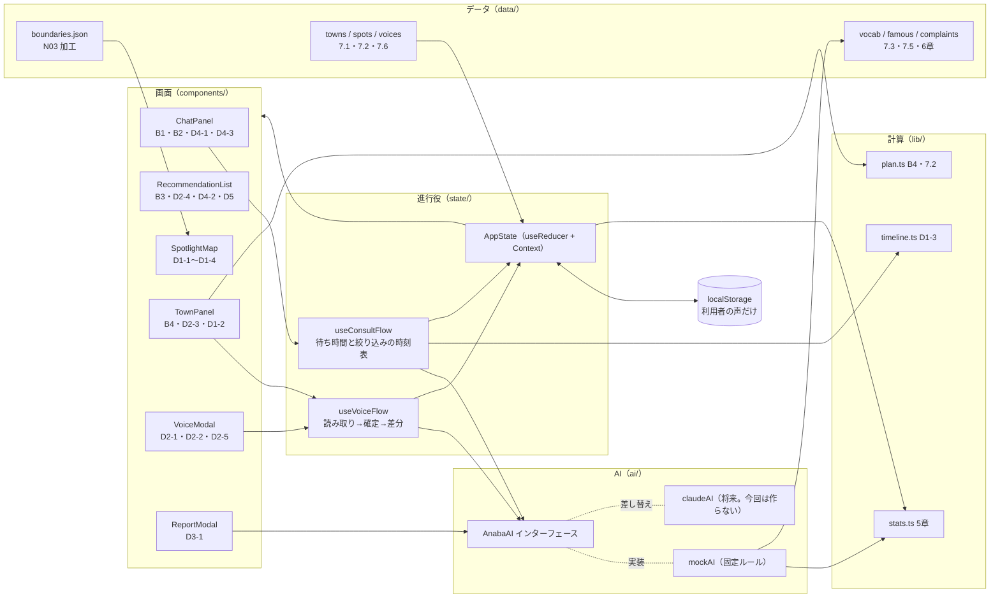
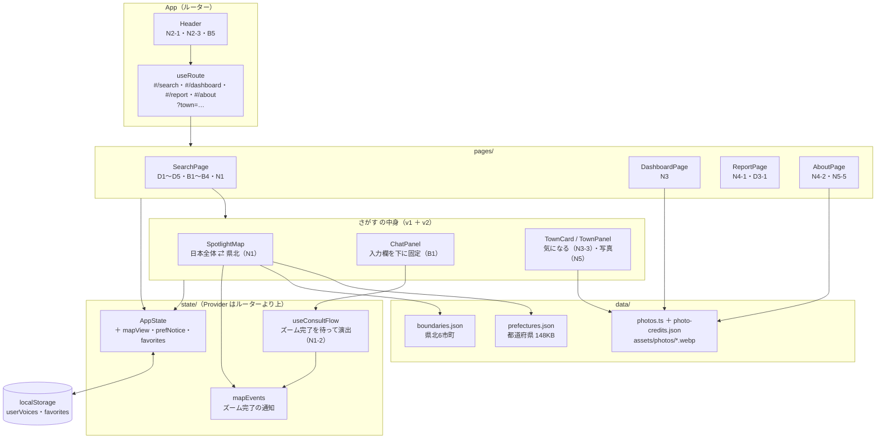
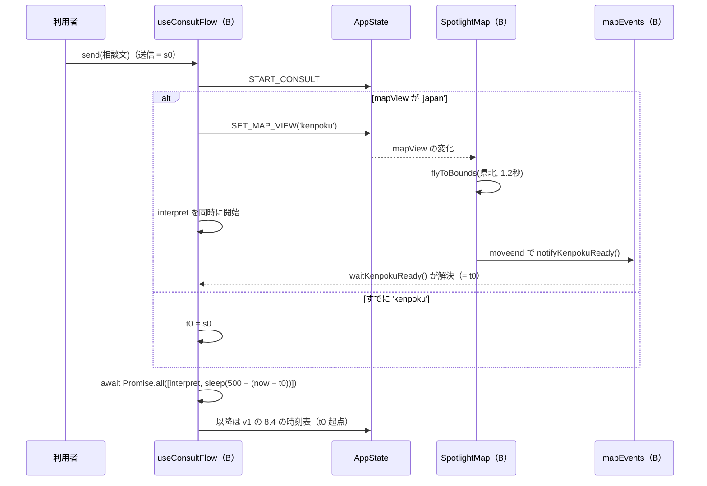

# 穴場 PoC 基本設計書

> **最終更新**: 2026-09-24（v2: 13章を追加。N1〜N5 と B1 の変更、3人での並列実装の分担。レビューを受けて 13.7・13.11 などを更新） / **オーナー**: 土井
> **位置づけ**: 暫定（[requirements-poc.md](requirements-poc.md) v2 を実装するための設計。要件が変われば追従する）
> **スコープ**: `poker` リポジトリ `poc` ブランチの `frontend/`（React + TypeScript + Vite + Tailwind CSS + Leaflet、バックエンドなし）。0〜12章は v1（D1〜D5・B1〜B5）の設計で、実装済み。v2 の追加分（N1〜N5、B1 の変更）は **13章** にまとめ、v1 の章と食い違うところは13章を優先する。要件の内容はここでは繰り返さず、要件定義書の ID（D1-1、N3-2、5章、7.4 など）で参照する。

---

## 0. この設計で決めたこと（要件に書かれていない判断）

実装者が迷いやすい点を先に決めておく。本文の該当章で詳しく書く。

| # | 論点 | 決定 |
| --- | --- | --- |
| 1 | 点数の丸め | 内部はすべて丸めない値で持つ。**表示・穴場ラベル・候補から外す判定（3.5／1）は小数第1位に丸めた値で行う**（画面の数字と判定を一致させるため） |
| 2 | 町の一言とタグの持ち方 | AI（`summarizeTown`）の出力を state に保存する。声から毎回 `useMemo` で導出はしない（Claude API に差し替えたとき非同期になるため） |
| 3 | 待ち時間の置き場所 | AI 関数の中には入れず、画面側の進行役（`useConsultFlow` / `useVoiceFlow`）で `Promise.all([ai.xxx(), sleep(ms)])` にする。Claude API に替えたとき、待ち時間が二重にならない |
| 4 | 条件を満たす町が4つ以上残ったとき | 上位3町だけ光らせる。4位以下は演出の最後に「上位3町に入らなかった」の理由で暗くする |
| 5 | 0件のときの「どの条件を緩めれば出るか」（B3） | 条件を1つずつ外して `recommend` をやり直し、1町以上出る条件を列挙する。予算と片道時間は「いくらにすれば出るか」の最小値も出す（4.3） |
| 6 | リセット（B5） | 確認ダイアログなしで即時に戻す（「ボタン1つ」を満たすため）。進行中の演出・待ち時間も止める |
| 7 | 背景地図のタイル | 使わない。暗い単色の背景＋SVG の市町村だけで描く（8章の「通信なし」を確実に満たすため） |
| 8 | 境界データ | N03（2025-01-01 版）の取得と mapshaper での軽量化を試し、**成功した**。`frontend/src/data/boundaries.json`（72KB）として同梱済み（8.2） |
| 9 | 初期データの声 | 満足度・知っていたか・タグ・根拠の文を明示的に書いて持つ。そのうえで「`analyzeVoice(感想文)` の結果と一致する」ことをテストで保証する（AI が読み取った値という建付けを守るため） |
| 10 | 感想を確定したあとの提案カード | 町の顔ぶれと並び（`Recommendation.candidateIds`）は相談時のまま固定する。カードの点数・一言・タグ・引用・一致タグ・裏付けの声は `lib/candidate.ts` の `buildCandidateView()` で**今の voices・summaries・stats から毎回導出する**。確定した声が D2-4 の条件に合えば、カードに戻ったとき先頭の引用になる（D2-3「画面に反映」） |
| 11 | 「町が持つタグ」の意味 | 雰囲気・有名地の一致度・似ている理由の判定は、すべて `summaries[townId].tags`（D5-2 の3〜5個）で行う。声のどれか1件にあるだけのタグは数えない（地図ラベルに出ているタグと判定を一致させるため） |

## 1. 全体構成

> v2 でルーティング・ヘッダー・4ページ・日本全体の地図・写真が加わった全体図は 13.1。



- データの流れは一方向。画面は `AppState` を読むだけで、変更は進行役（`useConsultFlow` / `useVoiceFlow`）か `dispatch` を通す
- 点数（5章）は `voices` から `computeAllStats()` で毎回導出する（`useMemo`）。保存しない
- 町の一言とタグ（D5）は AI の出力なので state に保存し、声を確定したときに作り直す（D5-3）

## 2. ディレクトリとファイル構成

> v2 で追加・変更するファイルと、その担当は 13.2。

`frontend/` 直下（雛形として足りないものも含む。★は同梱済み）。

```
frontend/
├── index.html                    # <html lang="ja">、viewport、<div id="root">
├── package.json                  # ★ 既存。scripts はそのまま（dev / build / test）
├── vite.config.ts                # react() + tailwindcss()、test: { environment: 'node' }
├── tsconfig.json                 # references: app / node（Vite 雛形と同じ構成）
├── tsconfig.app.json             # strict、resolveJsonModule、types: ["vite/client"]
├── tsconfig.node.json            # vite.config.ts 用
├── scripts/
│   └── build-boundaries.sh       # ★ N03 取得 → mapshaper で boundaries.json を再生成
└── src/
    ├── main.tsx                  # createRoot、leaflet/dist/leaflet.css と index.css を import
    ├── App.tsx                   # AppStateProvider + レイアウト
    ├── index.css                 # @import "tailwindcss"; 色トークン、reduced-motion 対応
    ├── types.ts                  # 3章の型すべて
    ├── data/
    │   ├── boundaries.json       # ★ 6市町の境界（GeoJSON、72KB）
    │   ├── vocab.ts              # 7.3 の20タグ：判定辞書・一言用の言葉・表示順
    │   ├── famous.ts             # 7.5 の有名地辞書10件
    │   ├── dictionaries.ts       # 満足度・知っていたか・不満・誰と の辞書（6章）
    │   ├── towns.ts              # 7.1・7.2 の町6件
    │   ├── spots.ts              # 7.2 のスポット
    │   ├── voices.ts             # 初期の声（7.6 の制約を満たす）
    │   ├── examples.ts           # 例文ボタン3つ（1つは 7.6 のデモ用の相談文）
    │   └── seed.test.ts          # データ制約のテスト（10章）
    ├── lib/
    │   ├── stats.ts              # 5章の計算
    │   ├── stats.test.ts
    │   ├── plan.ts               # 1日プランの時刻・費用、町の旅費（7.4 予算判定と共用）
    │   ├── plan.test.ts
    │   ├── candidate.ts          # 提案カードの中身（引用・一致タグ・裏付けの声・理由文）を導出。recommend と画面で共用
    │   ├── candidate.test.ts
    │   ├── timeline.ts           # D1-3 の時刻表を作る純関数
    │   ├── timeline.test.ts
    │   ├── text.ts               # 文の分割、全角数字・漢数字の正規化
    │   ├── text.test.ts
    │   ├── geo.ts                # 点が多角形の中にあるか（データのテスト用）
    │   ├── storage.ts            # localStorage の安全な読み書き
    │   ├── storage.test.ts
    │   ├── sleep.ts              # AbortSignal 対応の sleep
    │   └── format.ts             # 円・分・点数・日時の表示
    ├── ai/
    │   ├── types.ts              # AnabaAI インターフェースと入出力の型
    │   ├── index.ts              # export const ai: AnabaAI = mockAI（差し替え点はここだけ）
    │   └── mock/
    │       ├── index.ts          # mockAI（下の同期関数を Promise で包む）
    │       ├── interpret.ts
    │       ├── interpret.test.ts
    │       ├── recommend.ts
    │       ├── recommend.test.ts
    │       ├── analyzeVoice.ts
    │       ├── analyzeVoice.test.ts
    │       ├── summarizeTown.ts
    │       ├── summarizeTown.test.ts
    │       ├── buildReport.ts
    │       └── buildReport.test.ts
    ├── state/
    │   ├── reducer.ts            # AppState と Action、reducer
    │   ├── reducer.test.ts
    │   ├── AppStateProvider.tsx  # Context、初期化（localStorage 読み込み）、保存
    │   ├── selectors.ts          # useStats() など導出値のフック
    │   ├── useConsultFlow.ts     # 相談送信〜光が当たるまでの進行
    │   ├── useVoiceFlow.ts       # 感想の読み取り〜確定〜差分表示の進行
    │   └── useReducedMotion.ts   # matchMedia('(prefers-reduced-motion: reduce)')
    └── components/
        ├── Header.tsx            # タイトル、「サンプルデータ」バッジ、ResetButton
        ├── ResetButton.tsx
        ├── chat/                 # ChatPanel / MessageList / ExampleButtons / ChatInput
        ├── conditions/           # ConditionTags / ConditionEditor / FamousChip
        ├── recommend/            # RecommendationList / TownCard / NarrowingLog / EmptyResult
        ├── map/                  # SpotlightMap / useTownLayer / useSpotLayer / TownLabel
        ├── town/                 # TownPanel / SpotList / DayPlan / NoVoiceNotice
        ├── voice/                # VoiceModal / VoiceForm / AnalysisReview / ChangeSummary
        ├── report/               # ReportModal
        └── common/               # ScoreBadge / TagChip / VoiceQuote / Modal / Diff
```

- テストは対象ファイルの隣に `*.test.ts` で置く。コンポーネントのテストは書かない（10章）
- `boundaries.json` は拡張子 `.json` にする（Vite が追加設定なしで import できるため）

## 3. 型定義（`src/types.ts`）

```ts
// ---- 語彙（7.3）----
export const TAGS = [
  '静か', '自然', '渓谷', '滝', '海', '海鮮', '竹', '散策', '寺社', '高台',
  '夕焼け', '星空', '温泉', 'そば', 'カフェ', '歴史', '体験', '紅葉', '朝市', '避暑',
] as const;
export type Tag = (typeof TAGS)[number];          // 表示時に "#" を付ける。内部は "#" なし

export type TagCount = { tag: Tag; count: number };

// ---- 町・スポット・声（7.2）----
export type TownId = string;                        // 例: 'hitachiota'
export type SpotId = string;                        // 例: 'hitachiota-bamboo'
export type Companion = '友達と' | 'ひとり' | 'ふたり' | '家族と';
export type SpotKind = '食べる' | '見る' | '体験';
export type Known = 'known' | 'unknown' | 'unsure'; // 知っていた / 知らなかった / 不明

export interface Town {
  id: TownId;
  name: string;                 // '常陸太田市'
  code: string;                 // 行政区域コード '08212'（boundaries.json の properties.code と一致）
  oneWayMin: number;            // 東京駅からの片道所要時間（分）
  roundTripYen: number;         // 往復交通費（円・1人）
  companions: Companion[];      // 向いている相手
  labelPoint: [number, number]; // [lat, lng] 地図ラベルの位置（mapshaper -points inner で算出）
}

export interface Spot {
  id: SpotId;
  townId: TownId;
  name: string;
  kind: SpotKind;
  description: string;          // 声にない事実（店名・数字・営業時間）は書かない
  lat: number;
  lng: number;
  order: number;                // 1日プランで回る順番（1始まり）
  stayMin: number;
  moveMin: number;              // 次のスポットまでの移動時間。最後のスポットは 0
  costYen: number;              // 費用の目安（1人）
}

export interface Voice {
  id: string;
  spotId: SpotId;
  text: string;                 // 感想文の原文
  satisfaction: 1 | 2 | 3 | 4 | 5;
  known: Known;
  tags: Tag[];
  evidence: string;             // 根拠の文（text の一文）
  createdAt: string;            // ISO 8601
  source: 'seed' | 'user';
}

// ---- 有名地（7.5）----
export interface FamousPlace {
  id: string;
  name: string;                 // 表示名 '京都の竹林'
  aliases: string[];            // 照合語 ['京都の竹林', '嵐山の竹林', '嵯峨野', '竹林の小径']（長い順に照合）
  tags: Tag[];                  // 2〜4個
}

// ---- 相談の条件（B2・D4）----
export type Stay = '日帰り' | '泊まり';
export interface Conditions {
  companion: Companion | null;
  partySize: number | null;      // 表示のみ（7.4）
  stay: Stay | null;
  budgetYen: number | null;      // 1人あたり
  maxOneWayMin: number | null;
  moods: Tag[];                  // 雰囲気
  famous: FamousPlace | null;    // D4-1
  unknownFamous: string | null;  // D4-3 の「〇〇」
}

// ---- 点数（5章）----
export interface SpotStats {
  spotId: SpotId;
  count: number;                 // 声の件数
  satisfaction: number;          // 丸めない値
  knownRatio: number;
  fame: number;
  hole: number;                  // satisfaction - fame（丸めない値）
}
export interface TownStats {
  townId: TownId;
  count: number;                 // 町の声の合計件数
  satisfaction: number;
  fame: number;
  hole: number;
}
export interface StatsIndex {
  mean: number;                                  // 全体の平均満足度
  spots: Record<SpotId, SpotStats>;
  towns: Record<TownId, TownStats | null>;       // 声0件の町は null
}
export type HoleLabel = 'ど穴場' | '穴場' | 'やや穴場';

// ---- AI の出力（6章）----
export type InterpretResult =
  | { kind: 'conditions'; conditions: Conditions }
  | { kind: 'clarify'; question: string };        // B1: 聞き返し。条件タグは出さない

export type RuleId =
  | 'dayTrip' | 'oneWay' | 'budget' | 'companion' | 'mood' | 'famous'
  | 'satisfaction' | 'hole' | 'rank';             // rank = 上位3町に入らなかった（決定#4）

export interface Elimination { townId: TownId; rule: RuleId; reason: string } // reason は 7.4 の理由文

// 提案カードに出す内容。recommend の結果には保存せず、lib/candidate.ts の
// buildCandidateView() で「今の voices・summaries・stats」から毎回導出する（決定#10）
export interface CandidateView {
  townId: TownId;
  stats: TownStats;               // 穴場度・件数（D2-3）。StatsIndex から読む
  summary: TownSummary;           // 一言とタグ（D5）
  matchRate: number | null;       // 有名地のたとえがないとき null
  matchedTags: Tag[];             // D4-2。famous.tags のうち summary.tags にあるもの（famous.tags の順）
  famousEvidence: Voice | null;   // D4-2 の裏付けの声（4.4 の選び方）。該当なしなら null
  quotes: Voice[];                // D2-4 の根拠の声（0〜3件）
  reasonText: string | null;      // 根拠の声を引用したテンプレート文（4.2）。quotes が0件なら null
}

export interface RelaxHint {
  rule: Exclude<RuleId, 'satisfaction' | 'hole' | 'rank'> | null; // 2つ組・「3つ以上」は null
  label: string;                  // 「予算を約12,000円にする」「「日帰り」と「予算3,000円」を外す」
  townCount: number;              // その条件を緩めると出る町の数
  patch: Partial<Conditions> | null; // 押したときに条件へ当てる差分
}

export interface Recommendation {
  eliminated: Elimination[];      // 暗くする順（D1-3）
  candidateIds: TownId[];         // B3 の順、最大3。光らせる町。確定後も並びと顔ぶれは変えない
  relaxHints: RelaxHint[];        // candidateIds が0件のときだけ中身がある
  notices: string[];              // D4-3 の1行など
}

export interface VoiceAnalysis {
  satisfaction: 1 | 2 | 3 | 4 | 5;
  satisfactionDetermined: boolean; // false なら「判定できませんでした。直してください」
  known: Known;
  tags: Tag[];
  evidence: string;
}

export interface TownSummary {
  townId: TownId;
  catchphrase: string;            // 15字以内（D5-1）
  tags: TagCount[];               // 3〜5個、件数の多い順（D5-2）
}

export interface TownReport {
  townId: TownId;
  goodPoints: TagCount[];                         // 上位3
  complaints: { word: string; count: number }[];  // 0件なら画面で「目立った不満はなし」
  pitch: string | null;                           // 良い点が0件なら null
}
```

## 4. AI（モック）の関数と、Claude API への差し替え

### 4.1 インターフェース（`src/ai/types.ts`）

画面は `src/ai/index.ts` の `ai` だけを使う。すべて非同期にしておき、Claude API に替えても画面側を変えない。

```ts
export interface DataSnapshot {
  towns: Town[];
  spots: Spot[];
  voices: Voice[];
  stats: StatsIndex;
  summaries: Record<TownId, TownSummary>;
}

export interface AnabaAI {
  interpret(text: string): Promise<InterpretResult>;
  recommend(conditions: Conditions, data: DataSnapshot): Promise<Recommendation>;
  analyzeVoice(text: string, spot: Spot): Promise<VoiceAnalysis>;
  summarizeTown(town: Town, voices: Voice[]): Promise<TownSummary>;   // voices は町の声だけ
  buildReport(town: Town, voices: Voice[]): Promise<TownReport>;
}
```

- モックは `ai/mock/*.ts` に**同期の純関数**（`interpretSync` など）として書き、`ai/mock/index.ts` で `Promise.resolve()` に包む。テストは同期関数を直接呼ぶ
- 待ち時間はここに入れない（決定#3）

### 4.2 モックの詳細（6章の補足）

| 関数 | 補足ルール |
| --- | --- |
| `interpret` | ① 全角数字を半角にする。漢数字（一〜十）は**直後が「人」「泊」「万」「千」「時間」「分」のときだけ**数字にする（「一緒」「十分」を変えない）② 有名地: `famous.ts` の aliases を長い順に照合。見つかったら `famous` に入れ、その語を本文から取り除いてから雰囲気を判定する（「京都の竹林」の「竹林」を雰囲気の #竹 に数えない）③ 見つからず `(みたいな\|っぽい\|のような)` に当たれば（〇〇が 7.3 の判定語だけでできている「海っぽい」「竹林みたいな」は有名地ではなく雰囲気として読む）、その直前を、直前にある句読点・空白・助詞（は が を に で も へ と や）で区切った語を `unknownFamous` に入れる（「富良野みたいなところ」→ 富良野、「友達と、ハワイっぽい海に行きたい」→ ハワイ、「北海道の花畑みたいな所」→ 北海道の花畑。この3例をテストに入れる）④ 誰と: `dictionaries.ts` の COMPANION_WORDS を**次の優先順**で照合し、最初に当たったものを採る: 家族/子連れ/子ども → 家族と ＞ 友達/友人/仲間 → 友達と ＞ カップル/恋人/夫婦 → ふたり ＞ 人数の語（ひとり/1人/ソロ → ひとり、ふたり/2人 → ふたり）。「友達2人で」→ 友達と、「家族3人」→ 家族と。人数の語は `(?<!\d)1人`・`(?<!\d)2人` のように前が数字でないときだけ当てる（「11人」を ひとり にしない）⑤ 人数: `(?<!\d)(\d+)人`、「ひとり」→1、「ふたり」→2 ⑥ 泊まり: 泊/宿 → 泊まり、日帰り → 日帰り ⑦ 予算: `(\d+(?:\.\d+)?)(万\|千)?円` と `(\d+(?:\.\d+)?)万` を金額に（「1万円くらい」→10000、「5千円」→5000、「1.5万」→15000）⑧ 片道: `(\d+)時間(半)?以内`／`(\d+)分以内` → 分 ⑨ 雰囲気: `vocab.ts` の判定辞書。結果は `TAGS` の順 ⑩ 条件がすべて null・雰囲気0・有名地なしなら `clarify`（「誰と、どんな雰囲気のところに行きたいですか？」。`unknownFamous` だけあるときは先頭に D4-3 の1行を付ける） |
| `recommend` | 声0件の町（`stats.towns[id] === null`）は入力から外し、`eliminated` にも入れない。7.4 のルールを上から順に、残っている町に当てる（1町は最初に当たったルールでだけ外れる）。`eliminated` は外れた順。**町のタグは `data.summaries[townId].tags` を使う**（決定#11）。**雰囲気が複数あれば、そのすべてを持つ町だけ残す**。理由文の「#◯◯」には、`moods` の順で最初に欠けたタグを入れる。有名地は `matchRate(famous.tags, 町のタグ) === 0` で外す。残りを B3 の順（一致度 → 丸めた穴場度 → `towns.ts` の順）で並べ、上位3町を `candidateIds` に、4位以下は `rank`（理由文「上位3町に入らなかった」）で `eliminated` の末尾に足す。0件なら `relaxHints` を作る（4.3）。`unknownFamous` があれば `notices` に D4-3 の1行。カードの中身は返さない（決定#10。4.4 の `buildCandidateView` で作る） |
| `analyzeVoice` | 文の分割は `。！!？?\n`。満足度: POSITIVE（最高・また来たい・感動・良かった・よかった・素晴らしい・大満足）で+1、NEGATIVE（残念・微妙・がっかり・不便・期待外れ・良くなかった）で-1。語ごとに1回だけ数える。**否定形を先に照合して本文から消す**（「良くなかった」を「良かった」に数えない）。知っていたか: まず否定形（有名じゃない・有名ではない・知られていない）を本文から消し、次に UNKNOWN（知らなかった・初めて知った・名前も知らない）を判定、最後に KNOWN（前から気になって・有名・知っていた・何度目）。「有名じゃないけど最高」は「不明」になる。根拠の文: 満足度の判定語を含む最初の文 → なければタグの判定語を含む最初の文 → なければ最初の文 |
| `summarizeTown` | 6章のとおり。同数は `TAGS` の順。一言は、タグが2個以上なら `〇〇と△△の町`（15字超なら `〇〇の町`）、**1個なら `〇〇の町`**、0個なら「声を集めています」 |
| `buildReport` | 不満辞書: 駐車場・分かりにくい・わかりにくい・混んで・高い・閉まって・不便・案内がない。同じ意味の表記ゆれは代表語にまとめて数える。発信文テンプレ:「知らずに訪れた人が『{一言用の言葉A}』と『{B}』に満足した町、{町名}。」良い点が1つなら A だけの文、0なら null |

### 4.3 `recommend` の 0件ヒント

外した条件ごとに `recommend` を再計算して、1町以上出るものを `townCount` 付きで返す。

| 条件 | ヒントの作り方 |
| --- | --- |
| 日帰り | 「泊まりにする」 |
| 片道 X | ほかの条件を満たす町の片道所要時間の最小値 m を出し「片道を{m}分以内にする」 |
| 予算 Y | 同様に旅費の最小値 c を出し「予算を約{c を千円単位で切り上げ}円にする」 |
| 誰と | 「『{誰と}』を外す」 |
| 雰囲気（1タグずつ） | 「#{タグ} を外す」 |
| 有名地 | 「『{有名地}』のたとえを外す」 |

1つ外しても0件なら、2つ外せば出る組を「「A」と「B」を外す」の形で町の多い順に最大3件返す。それでも0件なら「条件を3つ以上緩めてください」を1件だけ返す（`townCount: 0`）。各ヒントには、押したときに条件へ当てる差分 `patch` を持たせ、画面で押すとその条件で探し直す（`patch: null` は押せない）。

### 4.4 提案カードの中身（`src/lib/candidate.ts`）

```ts
export function buildCandidateView(
  townId: TownId, conditions: Conditions, data: DataSnapshot,
): CandidateView;
export function selectQuotes(townVoices: Voice[]): Voice[];                       // D2-4
export function selectFamousEvidence(townVoices: Voice[], matchedTags: Tag[]): Voice | null; // D4-2
export function buildReasonText(townVoices: Voice[], quotes: Voice[]): string | null;
```

- `recommend`（並び順の一致度）と画面（`selectors.ts` の `useCandidateViews()`）の両方がこれを使う。画面は `recommendation.candidateIds` を `buildCandidateView` に通して毎回作るので、感想を確定すると点数・一言・タグ・引用がその場で変わる（決定#10）
- `selectQuotes`（D2-4）: ①「知らなかった」かつ満足度4以上を `createdAt` の新しい順 ② 3件に足りなければ、①に入っていない満足度4以上を新しい順で足す。最大3件。カードには `evidence` を出し、押すと `text`（原文）を展開する
- `selectFamousEvidence`（D4-2）: 町の声のうち満足度4以上で、`tags` と `matchedTags` の共通タグが1つ以上あるもの。共通タグの数が多い順 → 同数なら「知らなかった」を優先 → 新しい順で1件。表示は「#竹 #静か が一致。『{evidence}』」と「似た体験ができる」。該当がなければ `null` にし、一致タグだけ出す
- `buildReasonText`: n =「知らなかった」かつ満足度4以上の声の件数。n ≥ 1 なら「知らずに訪れて満足した人が{n}人。『{引用}』」、n = 0 なら「訪れた人の声:『{引用}』」、引用する声がなければ `null`（声で裏付けられない文は出さない。D2-4）。引用は、有名地のたとえがあればたとえに沿った声（`selectFamousEvidence` の次点。似ている理由の欄と同じ声を二度出さない。次点がなければ `famousEvidence`）、なければ `quotes[0]`。『』の中の文末の句点は落とす
- 有名地のたとえがないとき `matchRate`・`famousEvidence` は `null`、`matchedTags` は空

### 4.5 Claude API への差し替え

今回は作らない（9章）。差し替えるときは `src/ai/claude.ts` に `AnabaAI` を実装し、`src/ai/index.ts` の1行を替える。

| 関数 | Claude での作り方 | モックから残すもの |
| --- | --- | --- |
| `interpret` | tool use で `Conditions` の JSON スキーマを強制。語彙（20タグ）と有名地辞書をシステムプロンプトに入れる | 出力の検証（`TAGS` に無いタグは捨てる、有名地は辞書にあるものだけ） |
| `recommend` | **除外と並び順は今のコードのまま**（事実とルールで決まるため）。LLM は使わない | 除外ルール・順位・0件ヒント、`lib/candidate.ts` |
| `analyzeVoice` | 12章の方針どおり、最初に置き換える候補。`VoiceAnalysis` の JSON スキーマを強制 | 満足度の範囲外や未知タグの検証 |
| `summarizeTown` | 声の要約から一言とタグを作る。15字と語彙の制約は検証で落として再試行 | 失敗時はモックの結果にフォールバック |
| `buildReport` | 良い点と不満の集計はコードで行い、発信文だけ LLM | 集計 |

- 通信できないときは、各関数でモックにフォールバックする（8章の「通信なしでも動く」を保つ）
- API キーはブラウザに置かない。差し替える時点でプロキシ（サーバー）を別途用意する

## 5. 計算（5章）の関数（`src/lib/stats.ts`、`src/lib/plan.ts`）

```ts
// stats.ts
export function round1(x: number): number;                    // Math.round(x * 10) / 10
export function meanSatisfaction(voices: Voice[]): number;    // 声0件なら 3
export function spotStats(spotId: SpotId, spotVoices: Voice[], mean: number): SpotStats;
export function townStats(townId: TownId, spots: SpotStats[]): TownStats | null; // 件数で重み付け。合計0なら null
export function computeAllStats(towns: Town[], spots: Spot[], voices: Voice[]): StatsIndex;
export function holeLabel(hole: number): HoleLabel | null;     // round1 した値で判定
export function isReference(count: number): boolean;          // count < 5 →「参考値」（D2-3）
export function passesQuality(t: TownStats): { satisfaction: boolean; hole: boolean }; // round1 で 3.5 / 1
export function matchRate(famousTags: Tag[], townTags: Tag[]): number; // 0〜1

// plan.ts
export function townTripCost(town: Town, townSpots: Spot[]): number;   // 往復交通費 + スポット費用の合計（7.4・B4 共用）
export interface PlanRow { spot: Spot; start: string; stayMin: number; moveMin: number; costYen: number }
export interface DayPlan {
  title: '1日プラン' | '1日目のプラン';
  rows: PlanRow[];               // order 昇順。start は "10:00" から 7.2 の式で計算
  totalYen: number;              // townTripCost と同じ値
  overBudget: boolean;           // budgetYen があり totalYen > budgetYen
}
export function buildDayPlan(town: Town, townSpots: Spot[], conditions: Conditions | null): DayPlan;
```

- 声0件のスポット: `count: 0`、満足度は全体平均、知名度は `5 × 1/2 = 2.5`。町の重み付き平均では重み0なので影響しない
- `stats.ts` は `data/` を import しない（テストで任意のデータを渡せるようにする）

## 6. 状態管理（`src/state/`）

### 6.1 AppState

```ts
type ConsultPhase = 'idle' | 'thinking' | 'narrowing' | 'done';

interface AppState {
  userVoices: Voice[];                          // 利用者が確定した声（localStorage に保存する唯一のもの）
  summaries: Record<TownId, TownSummary>;       // D5。初期化時とリセット時は mock で同期計算
  messages: { id: string; role: 'user' | 'ai'; text: string }[];
  conditions: Conditions | null;                // null の間は条件タグを出さない（B1 の聞き返し時も null）
  recommendation: Recommendation | null;
  consultPhase: ConsultPhase;
  dimmed: TownId[];                             // 演出で暗くなった町（時刻表に沿って1つずつ増える）
  lit: TownId[];                                // 光っている町
  selectedTownId: TownId | null;                // D1-4 のズーム対象
  voiceModal: VoiceModalState | null;           // D2 の進行（下記）
  reportTownId: TownId | null;                  // D3
}

type VoiceModalState =
  | { step: 'writing'; spotId: SpotId }
  | { step: 'analyzing'; spotId: SpotId; text: string }
  | { step: 'review'; spotId: SpotId; text: string; analysis: VoiceAnalysis }
  | { step: 'result'; spotId: SpotId; change: VoiceChange };
```

- 導出値は `selectors.ts` のフックで `useMemo`: `voices = [...seedVoices, ...userVoices]`、`stats = computeAllStats(...)`、`candidateViews = recommendation.candidateIds.map(id => buildCandidateView(id, conditions, snapshot))`（決定#10。提案カードと光った町の地図ラベルはここから読む。町のパネルは光っていない町（D1-2 で暗い町を押したとき）も開くので、選んだ townId で `buildCandidateView` を呼んで作る）
- Action: `SEND_MESSAGE` / `SET_CONDITIONS` / `START_NARROWING` / `DIM_TOWN` / `LIGHT_TOWNS` / `SELECT_TOWN` / `OPEN_VOICE` / `SET_VOICE_STEP` / `ADD_VOICE` / `SET_SUMMARY` / `OPEN_REPORT` / `CLOSE_MODAL` / `RESET`
- reducer は純関数。時刻・乱数（声の id、createdAt）は Action の payload で渡す

### 6.2 進行役

**`useConsultFlow().send(text)`**（B1〜B3・D1-3）

1. 進行中の演出があれば `AbortController` で止める。`SEND_MESSAGE`（user）、`consultPhase = 'thinking'`、すべての町の暗さを初期状態に戻す
2. `t0 = performance.now()` を記録し、`const [r] = await Promise.all([ai.interpret(text), sleep(500, signal)])`
3. `clarify` なら AI の発言として `SEND_MESSAGE`（ai）、`conditions = null`、終了
4. `SET_CONDITIONS` → `ai.recommend(conditions, snapshot)` → `buildNarrowingTimeline()`（8.4）の各出来事を `setTimeout(fn, max(0, at − (performance.now() − t0)))` で予約する（`at` は送信時刻 t0 からの時刻。`interpret` と `sleep(500)` の待ちで約500ms たっているので、その分を引く）。`DIM_TOWN` を順に dispatch → `LIGHT_TOWNS` → `consultPhase = 'done'`。予約した timer は signal の abort で `clearTimeout` する
5. 条件タグを直したとき（B2）は `rerun(conditions)`: 手順1の停止と暗さの初期化のあと、手順4だけを `origin: 'rerun'`（t0 = その時刻）でやり直す

**`useVoiceFlow()`**（D2・D5-3）

1. `open(spotId)` → `writing`。入力画面にはそのスポットの点数を出さない（D2-1）
2. `submit(text)` → `analyzing` → `await Promise.all([ai.analyzeVoice(text, spot), sleep(1500, signal)])` → `review`（signal は B5 のリセットとモーダルを閉じたときに abort する。`ReportModal` の `buildReport` 待ちも同じ）
3. `confirm(edited: VoiceAnalysis)` →
   - `before = computeAllStats(現在の voices)`、`beforeSummary = summaries[townId]`
   - `ADD_VOICE`（id・createdAt をここで作る）
   - `after = computeAllStats(追加後の voices)`、`afterSummary = await ai.summarizeTown(town, 町の声)` → `SET_SUMMARY`
   - `change = diffVoiceChange(before, after, beforeSummary, afterSummary, spotId)` → `result`
4. `VoiceChange` は `{ spot: {hole, count, satisfaction, fame}, town: {hole, count}, tags: {tag, before, after, isNew}[] }`。各値は `[前, 後]` のタプル（D2-5）。`diffVoiceChange` は `lib/stats.ts` に置き、テストする

### 6.3 localStorage

| 項目 | 内容 |
| --- | --- |
| キー | `anaba-poc/v1/userVoices` |
| 保存するもの | `userVoices` だけ（初期の声はコードにあるので保存しない） |
| 書くタイミング | `userVoices` が変わったとき（`useEffect`） |
| 読むタイミング | Provider の初期化時。JSON として壊れている、配列でない、必須項目が欠けている、`spotId` が存在しない声は捨てる |
| 保存できない環境 | `lib/storage.ts` で読み書きをすべて try/catch。失敗しても state だけで動く（8章） |
| 一言とタグ | 保存しない。初期化時に全声から mock で作り直す（Claude に替えたら保存を検討） |

### 6.4 リセット（B5）

`ResetButton` → ① 進行中の `AbortController` を abort ② `storage.remove(key)` ③ `RESET`（初期 state に戻す。`summaries` は初期の声から作り直す）④ 地図を初期表示の範囲に戻す。確認ダイアログは出さない（決定#6）。

## 7. 画面構成とコンポーネント

### 7.1 レイアウト

> v2 ではヘッダーが全ページ共通になり（13.6）、チャットの入力欄の位置が変わる（B1、13.10）。

| 幅 | 構成 |
| --- | --- |
| PC（≥ 1024px） | 左に操作パネル（幅 420px、縦スクロール）、右に地図（残り全部・全高） |
| スマホ（375px） | 上に地図（高さ 50vh・固定）、下に操作パネル（スクロール）。モーダルは全画面のシート。絞り込みの演出中は、理由文を地図の上にも重ねて出す（パネルの理由一覧は画面外になるため） |

操作パネルの中身は上から: チャット → 条件タグ → 絞り込みの理由 → 提案カード。町を選ぶと、提案カードの位置に町のパネル（`TownPanel`）が重なる（「戻る」で提案カードに戻る）。

配色は暗い背景（`#0b1020` 系）に、光った町だけ琥珀色（`#fbbf24` 系）。文字色は背景とのコントラスト比 4.5:1 以上。フォントは OS 標準の日本語フォント（`system-ui, "Hiragino Sans", "Noto Sans JP", sans-serif`）だけを使い、Google Fonts などの外部フォントや CDN は読み込まない（8章の「通信なし」を満たすため。アイコンは同梱の `lucide-react`）。

### 7.2 コンポーネント一覧

| コンポーネント | 役割 | 満たす要件 |
| --- | --- | --- |
| `Header` | タイトル、「サンプルデータ」バッジ（7章冒頭の注意） | 7章 |
| `ResetButton` | 初期データに戻す | B5 |
| `ChatPanel` / `MessageList` / `ChatInput` | 相談の入力と会話。AI の聞き返しは AI の発言として出す | B1 |
| `ExampleButtons` | 例文3つ（`data/examples.ts`）。押すと即送信 | B1 |
| `ConditionTags` | 誰と・人数・日帰り/泊まり・予算・片道・雰囲気のタグ。読めない項目は「指定なし」 | B2 |
| `ConditionEditor` | タグを押すと開く編集ポップオーバー。確定で `rerun` | B2 |
| `FamousChip` | 「京都の竹林 → #竹 #静か #散策」 | D4-1 |
| `NoticeLine` | 「『〇〇』はまだ対応していないので、ほかの条件で探しました」 | D4-3 |
| `NarrowingLog` | 暗くなった町と理由文を、暗くなった順に追記。動きを減らす設定では一覧で一度に出す | D1-3、8章 |
| `RecommendationList` / `TownCard` | 最大3町。穴場度・穴場ラベル・件数（n=12、5件未満は「参考値」）・一言・タグ・根拠の声・似ている理由（「#竹 #静か が一致。『…』」「似た体験ができる」）。押すと町を選択 | B3、D2-3、D2-4、D4-2、D5-1、D5-2 |
| `EmptyResult` | 0件のときのヒント（4.3） | B3 |
| `SpotlightMap` | Leaflet 地図。市町村の塗り分け、スポットライト、ラベル、町クリック、ズーム、スポット・番号・線、出典表示 | D1-1〜D1-4 |
| `TownLabel` | 光った町のラベル（一言とタグ）。`L.divIcon` の中身 | D1-2、D5 |
| `TownPanel` | 選んだ町の穴場度・件数・一言・タグ、スポット一覧（スポットごとの点数と「感想を書く」）、「町向けレポート」ボタン | D1-2、D2-3、D5 |
| `NoVoiceNotice` | 声のない町を押したとき「まだ声が集まっていません」 | D1-2 |
| `DayPlan` | 時刻・場所・滞在・移動・費用の表、合計、予算超過の警告、「1日目のプラン」表記 | B4 |
| `VoiceModal` | `writing` → `analyzing` → `review` → `result` を切り替える。PC でも**背景（オーバーレイ）を不透明**にして、背後の `TownPanel` の点数を隠す | D2、D2-1 |
| `VoiceForm` | 感想の自由記述。点数は出さない | D2-1 |
| `AnalysisReview` | 満足度（1〜5）・知っていたか・根拠の文・タグ（20語から選択）を表示・編集して確定。判定できないときの警告 | D2-2 |
| `ChangeSummary` | スポットの穴場度・件数・満足度・知名度、町の穴場度・件数を「前 → 後」で強調。増えたタグ・新しいタグを目立たせる | D2-5 |
| `ReportModal` | 良い点の上位3（タグと件数）、不満（なければ「目立った不満はなし」）、発信文の案。開いてから 1.5秒待って表示 | D3-1 |
| `ScoreBadge` | 点数＋件数＋参考値＋ラベル | D2-3 |
| `VoiceQuote` | 根拠の文を引用。押すと原文を展開 | D2-4 |

## 8. 地図の実装方針

### 8.1 描画

- `L.map(el, { zoomControl: true, attributionControl: true, preferCanvas: false })`。**タイルレイヤーは追加しない**。地図コンテナの背景を CSS で暗い単色にする（D1-1、決定#7）
- 市町村は `L.geoJSON(boundaries, { renderer: L.svg(), style, onEachFeature })`。`feature.properties.code` → `Town.code` で町と結びつける
- スタイル（`fillOpacity` は0にしない。D1-2）

| 状態 | fill | fillOpacity | stroke |
| --- | --- | --- | --- |
| 初期（声あり） | `#334155` | 0.55 | `#94a3b8` 1px |
| 声なし（常に） | `#1e293b` | 0.25 | `#475569` 1px |
| 暗くなった | `#1e293b` | 0.25 | `#475569` 1px |
| 光った | `#fbbf24` | 0.85 | `#fde68a` 2px |
| 選択中 | 光ったと同じ＋ stroke 3px | | |

- 色の切り替えは `layer.setStyle()`。SVG の path に `transition: fill 400ms, fill-opacity 400ms` を CSS で付ける（動きを減らす設定では付けない）
- 町のクリック: 声のある町 → `SELECT_TOWN`、声のない町 → `NoVoiceNotice`（D1-2）。ホバーで stroke を強める
- ラベル: 光った町の `labelPoint` に `L.marker` + `L.divIcon`（`TownLabel` を `renderToStaticMarkup` で HTML 化）。タグは省略せず、スマホでは文字を小さくして折り返す
- 出典: `map.attributionControl.addAttribution('出典：「国土数値情報（行政区域データ）」（国土交通省）を加工して作成')`（D1-1）。Leaflet のロゴ表示は残してよい
- React との接続: `SpotlightMap` の `useEffect` で map を1回だけ作り、`useRef` に保持。state の変化は別の `useEffect` で `setStyle` / マーカー差し替えだけ行う（`react-leaflet` は使わない。依存を増やさないため）

### 8.2 境界データ（N03）

**2026-09-24 に取得と軽量化を試し、成功した。** 手順は `frontend/scripts/build-boundaries.sh` に残した。

| 手順 | 内容 | 結果 |
| --- | --- | --- |
| 取得 | `https://nlftp.mlit.go.jp/ksj/gml/data/N03/N03-2025/N03-20250101_08_GML.zip`（茨城県、2025-01-01 版） | 3.1MB。zip 内に GeoJSON が同梱されている |
| 抽出 | `N03_007`（行政区域コード）が 08202・08212・08214・08215・08225・08364 のもの | 220 → 67 図形 |
| 統合 | `-dissolve N03_007`（1町1図形。7.1） | 6図形（日立市のみ MultiPolygon） |
| 簡略化 | `-simplify 10% keep-shapes`、座標は小数4桁 | **72KB**（200KB 以下。7.1） |
| 出力 | `properties: { code, name }` | `src/data/boundaries.json` |

- 範囲: 経度 140.220〜140.806、緯度 36.475〜36.945。初期表示はこの範囲に `fitBounds`（padding 16px）
- ラベル位置（`mapshaper -points inner` で算出。`Town.labelPoint` に使う）: 日立市 [36.641, 140.635]、常陸太田市 [36.560, 140.519]、高萩市 [36.796, 140.598]、北茨城市 [36.846, 140.686]、常陸大宮市 [36.618, 140.342]、大子町 [36.791, 140.335]
  - 実装では、スマホ幅（375px）でラベル同士が重ならないよう、日立市 [36.67, 140.61]・常陸太田市 [36.52, 140.50]・北茨城市 [36.84, 140.66] に境界の内側でずらした（`seed.test.ts` で内側にあることを確認）
  - ラベルが地図の端からはみ出すときは内側へずらし、基準点が画面外にある町のラベルは隠す（ズーム中に端へ積み重ならないように）
- 利用条件: 国土数値情報は出典を明記すれば加工・再配布できる。出典文言は 8.1 のとおり

**取得できなくなった場合の代替**（上から順に試す）:

1. 同じ N03 を加工済みで公開している GitHub のデータ（例: `smartnews-smri/japan-topography`、`niiyz/JapanCityGeoJson`）から6市町を取り出し、同じ mapshaper コマンドで統合・簡略化する。出典は N03 のまま、加工元も併記する
2. 最終手段として、各市町の代表点から作る簡易な多角形（ボロノイ分割を県北の範囲で切る）で描き、画面に「境界は模式図です」と出す。D1-1 の「境界で区切る」を厳密には満たさないので、チームに報告する

### 8.3 町の中の表示（D1-4）

- 町を選ぶと、**その町のスポットを含む範囲**（`L.latLngBounds(スポット).pad(0.3)`）に `flyToBounds(…, { padding: [24, 24], maxZoom: 14, duration: 0.8 })` でズームする（町全体に合わせると、南北に長い常陸太田市などで番号ピンが重なるため。町の境界は画面外に出てよい）。動きを減らす設定では `fitBounds`（アニメーションなし）
- スポットの座標は、このズームでピン同士が 40px 以上離れるように置く（375px・PC の両方。`seed.test.ts` で `lib/geo.ts` の `fitZoom` と `pixelDistance` を使って確認）
- 町を選んでいるあいだは、全町のラベルを町名だけにする（一言とタグはパネルに出ている）
- スポット: `L.marker` + `L.divIcon` の丸い番号（`order`）。押すとスポット名と「感想を書く」を出す
- 1日プランの線: `order` 順の座標で `L.polyline`。明るい町の上でも見えるよう、暗い縁取り（7px）の上に明るい破線（3px）を重ねる。選んだ町の塗りは `fillOpacity` 0.55 に下げる
- 別の町を選ぶ・パネルを閉じるとスポットと線を消す。「戻る」で直前の範囲（全体）に戻す

### 8.4 絞り込み演出の時刻表（D1-3、6章の待ち時間）

`lib/timeline.ts`:

```ts
export type TimelineEvent =
  | { at: number; type: 'showConditions' }
  | { at: number; type: 'dim'; townId: TownId; reason: string }
  | { at: number; type: 'light'; townIds: TownId[] };
export function buildNarrowingTimeline(
  eliminated: Elimination[], litTownIds: TownId[],
  opts: { reducedMotion: boolean; origin: 'send' | 'rerun' },
): TimelineEvent[];
```

送信時（`origin: 'send'`、時刻は送信からのミリ秒）:

| 時刻 | 出来事 |
| --- | --- |
| 0 | 送信。「考えています…」を表示。町の暗さを初期状態に戻す |
| 500 | 条件タグを表示（`showConditions`） |
| 500 + k × Δ（k = 0…n−1） | `eliminated[k]` の町を暗くし、理由文を `NarrowingLog` に追記。Δ = min(600, 2500 ÷ n)。最後の暗転は 3000 以下 |
| 3500 | 残った町に光を当て、ラベルと提案カードを出す（`light`） |

- デモの相談文では n = 2 なので 500 と 1100 に暗転、3500 に光（4秒以内。D1-3）
- `rerun` のときは `showConditions` を省き、全体を 500 早める（暗転 0〜2500、光 3000）
- 動きを減らす設定: 500 に条件タグ、同じ 500 にすべての町を一度に暗くし（理由文は一覧）、同時に光を当てる。CSS の transition も無効（8章）
- 0件のとき: 最後の暗転の 500ms 後に `EmptyResult` を出す
- テスト: 送信起点のすべての出来事が `at ≤ 3500`、暗転が時刻順、n = 0〜5 で Δ の式どおり

## 9. サンプルデータ（7.6 を満たす作り方）

### 9.1 町（`data/towns.ts`）

片道所要時間と往復交通費は東京駅から特急ひたち（＋水郡線）を使う想定の目安。1人あたり。

| id | 町 | コード | 片道 | 往復交通費 | 向いている相手 | 声 | デモでの結果 |
| --- | --- | --- | --- | --- | --- | --- | --- |
| hitachi | 日立市 | 08202 | 90分 | 7,400円 | 友達と・ひとり・ふたり・家族と | あり | 残る（3位） |
| hitachiota | 常陸太田市 | 08212 | 110分 | 8,000円 | 友達と・ひとり・ふたり | あり | 残る（1位） |
| takahagi | 高萩市 | 08214 | 100分 | 8,400円 | 友達と・ひとり・ふたり・家族と | あり | 残る（2位） |
| kitaibaraki | 北茨城市 | 08215 | 115分 | 8,800円 | 友達と・ひとり・ふたり・家族と | あり | 暗く:「予算を超える（約11,400円）」 |
| hitachiomiya | 常陸大宮市 | 08225 | 120分 | 8,600円 | — | **なし** | 最初から暗い |
| daigo | 大子町 | 08364 | 170分 | 9,400円 | 友達と・ふたり・家族と | あり | 暗く:「日帰りには遠い（片道170分）」 |

デモの相談文の読み取り: 友達と・3人・日帰り・予算10,000円・片道 指定なし・雰囲気 #静か・有名地 京都の竹林（#竹 #静か #散策）。

7.4 を上から当てた結果: 日帰り → 大子町が外れる、予算 → 北茨城市が外れる、誰と・雰囲気（#静か）・有名地・満足度・穴場度 → 残り3町はすべて通る。並び順は一致度: 常陸太田市 1.0（3/3）＞ 高萩市 0.67（#静か #散策）＞ 日立市 0.33（#静か）。

### 9.2 スポットと声の方針

各町3〜4スポット。スポットの座標は町の境界の内側に置く（テストで確認）。説明文には声にない事実（店名・営業時間・数字）を書かない。

| 町 | スポット（種類・費用・声の件数） | 旅費の合計 | 町のタグの目標（満足度4以上の声の件数） | 町の値の目標 |
| --- | --- | --- | --- | --- |
| 常陸太田市 | ①西山の竹林の小径（見る・0円・**5件**＝デモで感想を書くスポット）②鯨ヶ丘の坂の町並み（見る・0円・10件）③常陸秋そばの店（食べる・1,200円・8件）④山あいの古刹（見る・300円・7件） | 9,500円 | #竹 6、#静か 5、#散策 4、#歴史 3、#そば 2（ほかのタグは1以下）→ 一言「竹と静けさの町」 | 満足度 約4.2、知名度 約1.9、穴場度 約2.3（穴場） |
| 高萩市 | ①花貫渓谷（見る・0円・14件）②渓谷沿いの遊歩道（体験・0円・8件）③山里の食堂（食べる・1,000円・6件） | 9,400円 | #渓谷 5、#静か 4、#散策 3、#紅葉 3、#自然 2（#竹 は0、ほかのタグは1以下）→「渓谷と静けさの町」 | 満足度 約4.1、知名度 約2.4、穴場度 約1.7（やや穴場） |
| 日立市 | ①御岩神社（見る・0円・12件）②かみね公園の高台（見る・0円・9件）③海の見える駅舎（見る・0円・8件）④海沿いのカフェ（食べる・1,000円・6件） | 8,400円 | #寺社 5、#高台 4、#海 3、#静か 3、#自然 2（#竹・#散策 は0、ほかのタグは1以下。#静か が5位以内から落ちるとデモが崩れる）→「古社と眺めの町」 | 満足度 約3.9、知名度 約2.7、穴場度 約1.2（やや穴場） |
| 北茨城市 | ①五浦海岸（見る・0円・15件）②あんこう料理の店（食べる・2,000円・10件）③海辺の温泉（体験・600円・7件） | 11,400円 | #海鮮 6、#夕焼け 4、#温泉 4、#海 3、#静か 2（ほかのタグは1以下）→「海鮮と夕焼けの町」 | 満足度 約4.5、知名度 約1.4、穴場度 約3.1（ど穴場） |
| 大子町 | ①袋田の滝（見る・300円・20件）②奥久慈のそば店（食べる・1,500円・9件）③山あいの温泉（体験・800円・6件） | 12,000円 | #滝 6、#紅葉 4、#そば 3、#自然 2、#温泉 2（#海鮮 は0、ほかのタグは1以下）→「滝と紅葉の町」 | 満足度 約4.3、知名度 約2.9、穴場度 約1.4（やや穴場） |
| 常陸大宮市 | スポット・声なし | — | — | null |

- 声の件数: デモのスポットは5件、それ以外は5〜20件（7.6）。全体で約150件
- 全体の平均満足度は 4.0〜4.2 に収める
- 満足度2以下の声を常陸太田市に2件（「駐車場」「分かりにくい」を含む。D3-1 の不満表示用）、大子町に2件（「混んで」）。**高萩市は満足度2以下を0件**にして「目立った不満はなし」を見せる
- 各町に「知らなかった」かつ満足度4以上の声を3件以上（D2-4 の引用用）。知っていたか「不明」の声も各町に数件混ぜる
- 投稿日時は 2026-04-01〜2026-09-20 に散らす（D2-4 の新しい順が効くように。発表日 2026-09-24 より前に収め、デモで確定した声が必ず `quotes[0]` になるようにする）
- 常陸太田市・高萩市・日立市には、#竹・#静か・#散策 を含む満足度4以上の声をそれぞれ1件以上（D4-2 の裏付け）

**デモで感想を書くスポット（常陸太田市①）の5件**（満足度の合計20、知っていた2・知らなかった3）:

| 感想文 | 満足度 | 知っていたか | タグ |
| --- | --- | --- | --- |
| 前から気になっていた竹林。人が少なくて良かった | 4 | 知っていた | #竹 #静か |
| 有名なのは知っていた。竹の音がよかった | 4 | 知っていた | #竹 |
| 初めて知った場所。竹林が静かで感動した | 4 | 知らなかった | #竹 #静か |
| 知らなかったけど、竹林の散歩道が最高だった | 4 | 知らなかった | #竹 #散策 |
| 地図で見つけた知らなかった竹林。また来たい | 4 | 知らなかった | #竹 |

デモの感想文（満足度5・知らなかった・#竹 #静か）を足したときの変化（全体平均 4.1 の場合）:

| 値 | 前 | 後 |
| --- | --- | --- |
| 満足度 | (5×4.1＋20)÷10 = 4.05 | (5×4.11＋25)÷11 ≒ 4.14 |
| 知っていた人の割合 | (2＋1)÷(5＋2) ≒ 0.429 | (2＋1)÷(6＋2) = 0.375 |
| 知名度 | 2.14 | 1.88 |
| **穴場度** | **1.9** | **2.3**（＋0.4、7.6 の 0.2 以上を満たす） |
| 件数 | n=5 | n=6 |
| 町のタグ | #竹 6・#静か 5 | #竹 7・#静か 6（件数増を強調） |

### 9.3 辞書

**`vocab.ts`（7.3）** — 判定辞書と一言用の言葉:

| タグ | 判定する言葉 | 一言用 |
| --- | --- | --- |
| 静か | 静か、人が少な、人がいな、独り占め、のんびり、落ち着 | 静けさ |
| 自然 | 自然、緑、森、山あい | 緑 |
| 渓谷 | 渓谷、峡谷、谷 | 渓谷 |
| 滝 | 滝 | 滝 |
| 海 | 海、海岸、浜 | 海 |
| 海鮮 | 海鮮、魚、刺身、あんこう、寿司 | 海鮮 |
| 竹 | 竹、竹林 | 竹 |
| 散策 | 散策、散歩、歩い、歩き、歩け、町並み、ぶらぶら | 散歩道 |
| 寺社 | 神社、寺、古刹、お参り | 古社 |
| 高台 | 高台、展望、見晴らし、眺め | 眺め |
| 夕焼け | 夕焼け、夕日、日の入り | 夕焼け |
| 星空 | 星 | 星空 |
| 温泉 | 温泉、湯 | 湯 |
| そば | そば、蕎麦 | そば |
| カフェ | カフェ、喫茶、コーヒー | カフェ |
| 歴史 | 歴史、昔、古い、城 | 歴史 |
| 体験 | 体験、作っ、手作り | 体験 |
| 紅葉 | 紅葉、もみじ | 紅葉 |
| 朝市 | 朝市、市場 | 朝市 |
| 避暑 | 涼し、避暑 | 涼しさ |

- 「竹の小道」は #竹 だけに当たり #散策 には当たらない（7.6 のデモの読み取り結果を守るため、「小道」「道」は #散策 に入れない）
- 「海鮮」は #海 にも当たるので、判定時は長い語から照合して、当たった部分を消してから次を照合する

**`famous.ts`（7.5）** — 10件:

| 有名地 | 照合語（aliases） | 体験のタグ |
| --- | --- | --- |
| 京都の竹林 | 京都の竹林、嵐山の竹林、嵯峨野、竹林の小径 | #竹 #静か #散策 |
| 軽井沢 | 軽井沢 | #避暑 #自然 #カフェ |
| 奥入瀬 | 奥入瀬 | #渓谷 #滝 #自然 |
| 鎌倉 | 鎌倉 | #寺社 #歴史 #散策 #海 |
| 箱根 | 箱根 | #温泉 #自然 #歴史 |
| 熱海 | 熱海 | #温泉 #海 #海鮮 |
| 函館 | 函館 | #海鮮 #朝市 #歴史 |
| 日光 | 日光 | #寺社 #滝 #紅葉 #歴史 |
| 高千穂峡 | 高千穂峡、高千穂 | #渓谷 #寺社 #自然 |
| 阿智村 | 阿智村 | #星空 #自然 #静か |

**例文ボタン（`examples.ts`）**:

1. 友達3人で日帰り、京都の竹林みたいな静かなとこ行きたい。予算は1万円くらい（7.6 のデモ用。上の結果）
2. ひとりで泊まり、温泉と海鮮でのんびりしたい（→ 北茨城市だけが残る。大子町は「誰と」（向いている相手に「ひとり」がない）で先に外れる）
3. 奥入瀬みたいな渓谷を家族で歩きたい。2時間以内で（→ 高萩市。D4 を別の有名地で見せる）

## 10. テスト方針（Vitest）

`environment: 'node'`。画面のテストは書かず、純関数だけを対象にする。`npm test`（`vitest run`）がすべて通ることを完了条件にする（11章）。

| ファイル | テストすること |
| --- | --- |
| `lib/stats.test.ts` | 5章の各式を手計算の値と照合（全体平均、ベイズ補正、「不明」を数えない、知名度0〜5、穴場度、件数重みの町の値、声0件のスポットと町）。穴場ラベルの境界（2.95→3.0 は「ど穴場」、0.94 はラベルなし）。一致度。`diffVoiceChange`（変化0.0でも前後を返す、新しいタグの `isNew`） |
| `lib/plan.test.ts` | 10:00 起点の時刻計算、合計費用、予算超過の警告、泊まりで「1日目のプラン」 |
| `lib/candidate.test.ts` | `selectQuotes`（知らなかった×満足度4以上を新しい順 → 足りなければ満足度4以上で補う、最大3件、重複なし）。`selectFamousEvidence`（共通タグ数 → 知らなかった → 新しい順、満足度3以下は選ばない、該当なしで `null`）。`buildReasonText`（n≥1 / n=0 / quotes 0件で `null`）。**確定した声を足して `buildCandidateView` をやり直すと、その声が `quotes[0]` になり、`stats.count` が1増える**（決定#10） |
| `lib/timeline.test.ts` | 8.4 の時刻表（光は 3500 以下、暗転は 500〜3000、動きを減らす設定で一度に、rerun で 500 早い） |
| `lib/storage.test.ts` | 壊れた JSON・不正な声を捨てる、`localStorage` が例外を投げても落ちない（`globalThis.localStorage` を差し替えて確認） |
| `ai/mock/interpret.test.ts` | デモの相談文で 9.1 の条件になる。「5千円」「5000円」「1万」「1.5万」、「2時間以内」「90分以内」。有名地の語が雰囲気に混ざらない。辞書にない「〇〇みたいな」で `unknownFamous` と1行。何も読めないと `clarify`。「〇〇」の切り出し3例（4.2）。誰との優先順（「友達2人で」→ 友達と、「家族3人」→ 家族と）、「11人」を ひとり にしない。「一緒に」「十分」が数字にならない |
| `ai/mock/recommend.test.ts` | 除外ルールの順番（1町は最初のルールで外れる）と理由文。有名地ありの並び（一致度→穴場度）、なしの並び（穴場度）。最大3件と `rank`。声0件の町を含めない。0件のときのヒント（予算・片道の最小値、1つ外しても0件のとき）。判定に `summaries` のタグを使う（声1件にだけあるタグでは残らない）。雰囲気が複数のとき全部を持つ町だけ残り、理由文は最初に欠けたタグ |
| `ai/mock/analyzeVoice.test.ts` | デモの感想文 → 満足度5・知らなかった・#竹 #静か。判定語なし → 3 と `satisfactionDetermined: false`。1〜5に収まる。「良くなかった」を加点しない。知っていた/不明の判定（「有名じゃないけど」は「不明」）。根拠の文 |
| `ai/mock/summarizeTown.test.ts` | 満足度4以上だけ数える、件数2以上を最大5、3個に届かないとき件数1を足す、同数は語彙順、15字超で1語の一言、タグ1個で「〇〇の町」、0個で「声を集めています」 |
| `ai/mock/buildReport.test.ts` | 良い点の上位3、不満の件数、**不満がないとき空配列**（画面で「目立った不満はなし」）、発信文（良い点2・1・0件） |
| `state/reducer.test.ts` | `ADD_VOICE` で `userVoices` が増える、`RESET` で初期 state、`DIM_TOWN` の重複なし |
| `data/seed.test.ts` | **7.6 のデモ制約**: デモの相談文で5町中2町が外れ、ちょうど3町が残る（順番も 9.1 のとおり）。デモの感想文でデモスポットの穴場度（丸め後）が 0.2 以上上がる。デモスポット以外の声が5〜20件。声のない町が1つだけ。全スポットの座標が町の境界の内側（`lib/geo.ts`）。全ての初期の声で `analyzeVoice(text)` の結果が保存値と一致。タグと有名地のタグがすべて20語の中。有名地が10件で各2〜4タグ。町の一言が15字以内、タグが3〜5個。すべての候補町が満足度3.5以上・穴場度1以上。`boundaries.json` のコードが towns と一致 |

## 11. 実装順（要件10章に沿う）

> v1 の実装順。v2 の実装順と3人の分担は 13.12。

各段階の終わりに `npm run build` と `npm test` を通してコミットする（push はしない）。

| 順 | 作るもの | ファイル | 終わりの確認 |
| --- | --- | --- | --- |
| 0 | 雛形 | `index.html`、`vite.config.ts`、`tsconfig*.json`、`main.tsx`、`App.tsx`、`index.css` | `npm run dev` で空の画面、`npm run build` が通る |
| 1 | データ・計算・モック・テスト | `types.ts`、`data/*`、`lib/stats.ts`・`plan.ts`・`candidate.ts`・`text.ts`・`geo.ts`、`ai/*`、各テスト、`seed.test.ts` | `npm test` がすべて通る（デモ制約を含む） |
| 2 | リセット・B1〜B3・D1-1・D1-2 | `state/*`（reducer・Provider・storage・selectors）、`Header`、`ResetButton`、`chat/*`、`conditions/*`、`recommend/*`、`map/SpotlightMap`（塗り分け・スポットライト・ラベル・クリック・出典）、`town/NoVoiceNotice` | 例文ボタンで3町が光る（演出なしで即時）。声のない町で案内が出る |
| 3 | D2・D5 | `useVoiceFlow`、`selectors.ts` の `useCandidateViews`、`voice/*`、`town/TownPanel`・`SpotList`、`common/ScoreBadge`・`VoiceQuote` | デモの感想文で「1.9 → 2.3」などが強調され、地図ラベルのタグ件数が増える。提案カードに戻るとデモの声が先頭の引用になる。再読み込みしても声が残る |
| 4 | D4 | `FamousChip`、`NoticeLine`、`TownCard` の似ている理由 | 「京都の竹林 → #竹 #静か #散策」と一致タグ＋裏付けの声 |
| 5 | B4・D1-4 | `lib/plan.ts` の画面接続、`town/DayPlan`、`map` のズーム・番号・線 | 町を選ぶとズームし、番号と線が出る。予算超過の警告 |
| 6 | D3 | `report/ReportModal` | 高萩市で「目立った不満はなし」 |
| 7 | D1-3 | `lib/timeline.ts`、`useConsultFlow`、`NarrowingLog`、`useReducedMotion` | 送信から 3.5秒で光る。OS の「視差効果を減らす」で一度に暗くなる |
| 8 | 仕上げ | 375px とPC での崩れ確認、通信を切ってデモの流れを通す、11章の完了条件を確認 | 11章のチェックリストがすべて埋まる |

## 12. 未決事項（設計側）

- 往復交通費・所要時間は目安。舞台が決まったら実際の経路で作り直す（要件12章）
- 境界データは 2025-01-01 版。市町村合併があれば `scripts/build-boundaries.sh` の URL とコードを更新する

---

## 13. v2 の追加設計（N1〜N5・B1 の変更）

v1（0〜12章）の動きは変えない。v2 で変える v1 の部分は、この章で名指しする。

### 13.0 v2 で決めたこと

| # | 論点 | 決定 |
| --- | --- | --- |
| 12 | ルーティング | ライブラリは使わず自前（`lib/route.ts` の純関数＋`useRoute` フック）。ハッシュは `#/search`・`#/dashboard`・`#/report`・`#/about`。町を指定して開くときはクエリ `?town=<TownId>` を付ける（`#/search?town=hitachiota`、`#/report?town=takahagi`）。依存を増やさず、4ページ・1パラメータなら数十行で足りるため |
| 13 | ページをまたぐ状態 | `AppStateProvider` をルーターより上に置き、会話・条件・提案・選んだ町・自分の声・気になる町はページを移っても残す。ページのコンポーネントだけを切り替える |
| 14 | 自分の声の印（要件8章） | 別の印は作らず、`Voice.source === 'user'` を印とする。利用者の声は v1 から `anaba-poc/v1/userVoices` に保存しているので、そのまま使う（初期の声は `source: 'seed'`） |
| 15 | 気になる町の保存 | `anaba-poc/v1/favorites` に `TownId[]`（押した順）。読み込み時に `TOWNS` にない id を捨てる |
| 16 | 地図の表示範囲 | `AppState.mapView: 'japan' \| 'kenpoku'`。最初は `'japan'`。町を選ぶ（`SELECT_TOWN`）と reducer が必ず `'kenpoku'` にする |
| 17 | 都道府県境界 | 国土数値情報 N03（2025-01-01 版）全国データの「都道府県単位」ファイルを mapshaper で軽量化し、`data/prefectures.json`（**実測 148KB、gzip 38KB**）として同梱。市町村境界と同じ出典なので、出典表示は1つで済む（13.7） |
| 18 | 県北でのズーム中の都道府県 | 県北を表示しているあいだは都道府県レイヤーを消す（簡略化した県境の粗さが、細かい市町村境界の横で目立つため）。v1 の見た目がそのまま残る |
| 19 | ズームと絞り込みの時刻 | 相談を送ったとき日本全体を表示中なら、`interpret` とズーム（1.2秒）を同時に始め、**ズームが終わった時刻を D1-3 の時刻表の起点 t0** にする（13.7.4） |
| 20 | 写真の入手元 | 主に Wikimedia Commons（API でライセンスを機械的に確かめられるため）。使ってよいライセンスは CC0・パブリックドメイン・CC BY（2.0/3.0/4.0）と、Unsplash License・Pexels License。CC BY-SA・NC・ND・GFDL は使わない（13.11） |
| 21 | 写真の形式 | WebP、横 1200px・3:2 に切り抜き、1枚 150KB 以下（目標 120KB）。`src/assets/photos/` に置き、Vite にハッシュ付きで同梱する |
| 22 | 町向けレポート | v1 のモーダル（`ReportModal`）はやめ、`#/report` のページにする。町の詳細の「町向けレポートを開く」は `#/report?town=<id>` へ移る（N4-1） |
| 23 | 並列実装 | 担当A（N2・N3・N4・B1）、担当B（N1）、担当C（N5）。共有ファイルは持ち主を1人に決め、ほかの担当は持ち主が用意する部品や状態を使うだけにする（13.12） |

### 13.1 全体構成（v2）



- ページを切り替えても `AppState` は消えない（決定#13）。「さがす」を離れているあいだも、進行中の絞り込みの timer は動き続け、戻ると結果が出ている
- 「さがす」に戻ると `SpotlightMap` は作り直される。作り直した直後の1回は、今の `mapView`・`selectedTownId`・`lit` をアニメーションなしで反映する（13.7.5）

### 13.2 ディレクトリとファイル（追加・変更と担当）

担当の分け方は 13.12。**★ = 新規、◆ = v1 のファイルを変更**。

```
frontend/
├── package.json                    ◆ C: devDependencies に sharp、scripts に "photos"
├── scripts/
│   ├── build-prefectures.sh        ★ B: 都道府県境界を作る（13.7.1）
│   ├── fetch-photos.mjs            ★ C: 写真の取得・検証・WebP 変換・出典の書き出し（13.11.3）
│   └── photo-sources.json          ★ C: 使う写真の一覧（対象 → Commons のファイル名 など）
└── src/
    ├── App.tsx                     ◆ A: ルーター（Header ＋ ページの切り替え）
    ├── index.css                   ◆ A: ヘッダーとページ共通のスタイルだけ（B・C は自分の CSS ファイルを持つ）
    ├── pages/                      ★ A
    │   ├── SearchPage.tsx          ★ A: v1 の App.tsx の Layout を移す。?town= の反映
    │   ├── DashboardPage.tsx       ★ A: N3
    │   ├── ReportPage.tsx          ★ A: N4-1
    │   └── AboutPage.tsx           ★ A: N4-2
    ├── lib/
    │   ├── route.ts / route.test.ts        ★ A: ハッシュの解析と組み立て
    │   ├── dashboard.ts / dashboard.test.ts ★ A: N3 の一覧・数字を作る純関数
    │   ├── japan.ts / japan.test.ts        ★ B: 日本全体の範囲・ズーム時間・都道府県の型と照合
    │   └── storage.ts / storage.test.ts    ◆ A: favorites の読み書きを追加
    ├── state/
    │   ├── reducer.ts / reducer.test.ts    ◆ A: mapView・prefNotice・favorites と Action を追加（B の分も A が入れる）
    │   ├── AppStateProvider.tsx            ◆ A: favorites の読み込み・保存
    │   ├── useReset.ts                     ◆ A: favorites も消す
    │   ├── useRoute.ts                     ★ A: 今のルートと navigate
    │   ├── mapEvents.ts                    ★ B: 「県北へのズームが終わった」の通知
    │   └── useConsultFlow.ts               ◆ B: ズーム完了を待ってから時刻表を始める
    ├── data/
    │   ├── prefectures.json        ★ B
    │   ├── attributions.ts         ★ B: 境界データの出典の文言（地図と「穴場度とは」で共用）
    │   ├── photos.ts               ★ C: 写真の取得関数と型
    │   ├── photo-credits.json      ★ C: 出典の記録（N5-5）
    │   └── photos.test.ts          ★ C
    ├── assets/photos/*.webp        ★ C: 23枚（町6・スポット17）
    └── components/
        ├── Header.tsx              ◆ A: ナビゲーション（N2）
        ├── nav/NavLinks.tsx        ★ A
        ├── nav/MobileMenu.tsx      ★ A
        ├── chat/ChatPanel.tsx      ◆ A: B1 の変更
        ├── common/FavoriteButton.tsx ★ A: N3-3
        ├── recommend/TownCard.tsx  ◆ A: 気になるボタン＋ C の <TownPhoto> を置く
        ├── town/TownPanel.tsx      ◆ A: 気になるボタン、レポートへのリンク、C の <TownPhoto>・<SpotPhoto> を置く
        ├── town/DayPlan.tsx        ◆ C: 各行に <SpotPhoto size="thumb">
        ├── report/ReportModal.tsx  ◆ A: 削除し、中身を ReportView.tsx に移す
        ├── report/ReportView.tsx   ★ A
        ├── report/TownSelect.tsx   ★ A
        ├── dashboard/*.tsx         ★ A: SummaryStats・MyVoiceList・VisitedTownList・FavoriteTownList・EmptyGuide
        ├── about/*.tsx             ★ A: ConceptSection・FormulaSection・CorrectionChart・DataSources
        ├── map/SpotlightMap.tsx    ◆ B: 日本全体の表示、県北へのズーム、準備中の表示、「日本全体を見る」
        ├── map/japanLayer.ts       ★ B: 都道府県レイヤーの生成とスタイル
        ├── map/map.css             ★ B: 地図まわりの追加スタイル（index.css には書かない）
        └── photo/                  ★ C
            ├── Photo.tsx           ★ C: 写真＋「イメージ写真」表示＋読み込めないときの代わり
            ├── TownPhoto.tsx / SpotPhoto.tsx ★ C
            ├── PhotoCredits.tsx    ★ C: 出典の一覧（N5-5。A が AboutPage に置く）
            ├── PhotoListNote.tsx   ★ C: サムネイル一覧に添える「イメージ写真」の1行（N5-2）
            └── photo.css           ★ C
```

- `types.ts` は v2 では**変更しない**。新しい型はそれぞれの持ち主のモジュールに置く（ルート → `lib/route.ts`、都道府県 → `lib/japan.ts`、写真 → `data/photos.ts`）
- `vite.config.ts`・`data/towns.ts`・`data/spots.ts`・`data/voices.ts`・`data/seed.test.ts` は v2 では変更しない（写真は `photos.ts` 側で townId / spotId に結びつける）

### 13.3 型定義（追加）

```ts
// lib/route.ts（A）
export type Page = 'search' | 'dashboard' | 'report' | 'about';
export type Route =
  | { page: 'search'; town: TownId | null }
  | { page: 'dashboard' }
  | { page: 'report'; town: TownId | null }
  | { page: 'about' };

// state/reducer.ts（A。B が使うものも含む）
export type MapView = 'japan' | 'kenpoku';
interface AppState {
  // …v1 の項目…
  mapView: MapView;                 // N1。初期値 'japan'
  prefNotice: string | null;        // N1-3。押した都道府県の名前（例: '栃木県'）。null で非表示
  favorites: TownId[];              // N3-3。押した順。localStorage に保存
}
type Action =
  // …v1 の Action…
  | { type: 'SET_MAP_VIEW'; view: MapView }     // 'japan' にすると selectedTownId・noVoiceTownId・prefNotice を消す
  | { type: 'SHOW_PREF_NOTICE'; name: string | null }
  | { type: 'TOGGLE_FAVORITE'; townId: TownId };
// 既存の SELECT_TOWN は、townId が null でなければ mapView も 'kenpoku' にする（決定#16）

// lib/japan.ts（B）
export interface PrefectureProps { code: string; name: string }   // code は '01'〜'47'、name は '茨城県'
export type Prefectures = FeatureCollection<Polygon | MultiPolygon, PrefectureProps>;
export const JAPAN_VIEW_BOUNDS: [[number, number], [number, number]] = [[26.0, 127.5], [45.6, 146.0]]; // 沖縄本島〜北海道
export const KENPOKU_ZOOM_MS = 1200;   // N1-2 の「1.5秒以内」
export const JAPAN_MIN_ZOOM = 4;       // 日本全体のときの minZoom。375×406px の地図で JAPAN_VIEW_BOUNDS が収まるズームは約 4.46、PC（860×744）は約 5.37（実測の計算）。小さいほうに合わせる
export const KENPOKU_MIN_ZOOM = 8;     // 県北のときの minZoom（v1 の値）
export const MAX_ZOOM = 15;            // v1 の値。どちらの表示でも同じ
export const KENPOKU_PREF_CODE = '08';

// data/photos.ts（C）
export type PhotoTarget = { kind: 'town'; id: TownId } | { kind: 'spot'; id: SpotId };
export interface PhotoCredit {
  id: string;                 // 'spot-hitachiota-bamboo' のように kind-id
  target: PhotoTarget;
  file: string;               // 'spot-hitachiota-bamboo.webp'
  width: number;              // 変換後（≤ 1200）
  height: number;
  bytes: number;              // 変換後（≤ 150KB）
  title: string;              // 入手元での題名
  author: string;             // 撮影者（HTML を除いた文字列）
  authorUrl: string | null;
  sourceUrl: string;          // 入手元のページ（Commons のファイルページなど）
  license: 'CC0' | 'Public domain' | 'CC BY 2.0' | 'CC BY 3.0' | 'CC BY 4.0' | 'Unsplash License' | 'Pexels License';
  licenseUrl: string;
  changes: string;            // 'リサイズ・切り抜き・WebP に変換'（CC BY の「変更の表示」）
  retrievedAt: string;        // '2026-09-24'
}
export interface PhotoRef { src: string; alt: string; credit: PhotoCredit }
export function getTownPhoto(townId: TownId): PhotoRef | null;
export function getSpotPhoto(spotId: SpotId): PhotoRef | null;
```

### 13.4 状態管理の変更（A）

| 項目 | 内容 |
| --- | --- |
| Provider の位置 | `main.tsx` → `App`（`AppStateProvider` の中にルーター）。ページを移っても state は残る（決定#13） |
| 自分の声 | v1 のまま `userVoices`（`anaba-poc/v1/userVoices`）。ダッシュボードは `userVoices` だけを使い、初期の声は含めない（N3-1） |
| 気になる町 | `favorites` を `anaba-poc/v1/favorites` に保存。`lib/storage.ts` に `loadFavorites(townIds)`・`saveFavorites`・`clearFavorites` を足す（読み込みで重複と未知の id を捨てる。保存できない環境でも動く） |
| 保存のタイミング | `userVoices` と同じく、`favorites` が変わったとき `useEffect` で保存（初回の読み込み直後は保存しない） |
| リセット（B5） | `useReset`: 進行中のタスクを止める → `clearUserVoices()`・`clearFavorites()` → `RESET`。`RESET` は `mapView: 'japan'`・`favorites: []`・`prefNotice: null` を含む初期状態に戻す。**今いるページは変えない**（ダッシュボードで押せば「何もないとき」の表示になる） |
| mapView | 初期 `'japan'`。`SET_MAP_VIEW`・`SELECT_TOWN`（null 以外で `'kenpoku'`）・`RESET` で変わる。地図（B）はこれを読んでズームする |
| prefNotice | 日本全体で茨城県北以外を押したとき（B が dispatch）。`SET_MAP_VIEW`・`SELECT_TOWN`・`RESET` で消す |

### 13.5 ルーティング（A）

- `lib/route.ts`（純関数。テストする）
  - `parseHash(hash: string): Route` … `''`・`'#'`・`'#/'`・未知のページは `{ page: 'search', town: null }`。`?town=` は `TOWNS` にある id だけ採る（ないものは null）。`search` と `report` 以外に付いた `?town=` は無視
  - `toHash(route: Route): string` … `{ page: 'search', town: null }` → `'#/search'`、town ありは `'#/search?town=hitachiota'`
- `state/useRoute.ts`
  - `useRoute(): Route` … `useSyncExternalStore` で `hashchange` と独自イベント `anaba:route` を購読
  - `navigate(route, { replace = false })` … `replace` なら `history.replaceState(null, '', toHash(route))` のあと `anaba:route` を発火（`replaceState` は `hashchange` を出さないため）。そうでなければ `location.hash = toHash(route)`
  - 起動時にハッシュが正規形でなければ（空・未知・不正な town）`navigate(parse した結果, { replace: true })` で直す。再読み込みで同じページが開く（N2-2）
- リンクは `<a href={toHash(route)}>`（新しいタブで開ける・キーボードで押せる）
- **「さがす」で町を開く**（N3-1・N3-3 の一覧、`#/search?town=X` の直打ち）
  - `SearchPage` で `route.town` が変わったら、声のある町なら `SELECT_TOWN(X)`（→ mapView は `'kenpoku'`、地図はズーム）、声のない町なら `SET_MAP_VIEW('kenpoku')` と `SHOW_NO_VOICE(X)`
  - 逆向き: `state.selectedTownId` が変わったら `navigate({ page: 'search', town: selectedTownId }, { replace: true })`。戻るボタンの履歴を町の選択で埋めないため `replace`
  - ループを防ぐため、どちらも「今の値と違うときだけ」行う
- **「レポート」で町を開く**（N4-1）: `TownPanel` の「町向けレポートを開く」は `navigate({ page: 'report', town })`。`ReportPage` で町を選び直したら `replace` で `?town=` を更新
- ページを移ったらスクロールを先頭に戻し、`document.title` を「穴場 — さがす」などに変える

### 13.6 ヘッダーとスマホのメニュー（A、N2）

| 幅 | 構成 |
| --- | --- |
| PC（≥ 768px） | 左: ロゴ「穴場」（`#/search` へのリンク）＋「サンプルデータ」バッジ。中央: 4つのリンク（さがす／ダッシュボード／町向けレポート／穴場度とは）。右端: リセット |
| スマホ（< 768px） | 左: ロゴ。右: リセット（アイコンのみ＋`aria-label`）とメニューボタン（`Menu` アイコン、`aria-expanded`・`aria-controls`）。高さは1行（`h-14`）のまま。「サンプルデータ」バッジはメニューの中に移す |

- 今いるページのリンクに `aria-current="page"` と強調（琥珀色の下線＋文字色）。判定は `useRoute().page`
- スマホのメニュー（`MobileMenu`）: ヘッダー直下に全幅で開くパネル。リンクを押す・`Escape`・外側を押す・ページが変わると閉じる。開いたら最初のリンクにフォーカス、閉じたらメニューボタンにフォーカスを戻す
- ヘッダーは全ページ共通で、`App` の一番上に `sticky top-0 z-[1500]` で置く（モーダル z-[2000] より下、地図の Leaflet コントロールより上）
- `ReportModal` 削除に合わせ、v1 の `Header.tsx` の中身（タイトル・リセット）はこのヘッダーに統合する
- v1 の `App.tsx` の操作パネルの下にある注意書き（「感想・費用・所要時間はサンプル（架空または目安）です。境界データは…」）は、`SearchPage` の操作パネルの下にそのまま残す（B1 の変更後は、スクロールする会話の欄の末尾）。出典は地図の右下の出典表示（B）と「穴場度とは」（A）にも出る

### 13.7 日本全体の地図（B、N1）

#### 13.7.1 都道府県境界データ

**2026-09-24 に取得と軽量化を試し、成功した。** B は同じ手順を `scripts/build-prefectures.sh` にし、出力を同梱する。

| 手順 | 内容 | 結果 |
| --- | --- | --- |
| 入手元 | 国土数値情報「行政区域」N03 2025-01-01 版の全国データ `https://nlftp.mlit.go.jp/ksj/gml/data/N03/N03-2025/N03-20250101_GML.zip`（632MB） | zip の中に都道府県単位のファイル `N03-20250101_prefecture.shp`（178MB、121,990 図形）がある。これだけを取り出す |
| ライセンス | 国土数値情報ダウンロードサイトの利用規約に従い、出典を明記すれば加工・再配布できる（市町村境界と同じ。8.2）。確認方法: データセットのページ（N03）の「使用許諾条件」欄と利用規約のページを見て、変更がないかを実装時に確かめる | 出典の文言は市町村と共通: 「出典：「国土数値情報（行政区域データ）」（国土交通省）を加工して作成」 |
| 統合 | `-each 'code=N03_007.slice(0,2)' -dissolve code copy-fields=N03_001 -rename-fields name=N03_001` | 47図形 |
| 小島の除去 | `-filter-islands min-area=15km2` | 日本全体の縮尺で見えない島を落とす |
| 簡略化 | `-simplify 0.1% keep-shapes -filter-islands min-vertices=4 -o precision=0.001 format=geojson` | **148KB（gzip 38KB）**。目標は 200KB 以下（`japan.test.ts` で確認） |

```sh
# scripts/build-prefectures.sh の中身（要点）
unzip -o "$WORK/all.zip" 'N03-20250101_prefecture.*' -d "$WORK"
npx -y mapshaper@0.6 -i "$WORK/N03-20250101_prefecture.shp" encoding=utf8 \
  -each 'code=N03_007.slice(0,2)' -dissolve code copy-fields=N03_001 -rename-fields name=N03_001 \
  -filter-islands min-area=15km2 \
  -simplify 0.1% keep-shapes -filter-islands min-vertices=4 \
  -o precision=0.001 format=geojson src/data/prefectures.json
```

- 実測では 0.3% で 614KB、0.15% で 214KB だったため 0.1% にした。日本全体の縮尺（375px 幅で全国が収まる程度）で県境の形は十分に分かる
- 取得できないときの代替: v1 の 8.2 と同じく、N03 を加工済みで公開している GitHub のデータ（例: `smartnews-smri/japan-topography`、`dataofjapan/land`）から都道府県単位のものを使い、同じ簡略化をかける。ライセンスと元データを README で確かめ、出典を併記する
- `data/attributions.ts`（B）に出典の文言を定数で置き、地図の出典表示と「穴場度とは」（A）の両方で使う

#### 13.7.2 表示（mapView = 'japan'）

- レイヤーの重なり（下から）: 都道府県（`japanLayer`）→ 県北6市町（v1 の `boundaries.json`）→ ラベル
- スタイル

| 対象 | fill | fillOpacity | stroke |
| --- | --- | --- | --- |
| 都道府県（茨城県を含む） | `#1e293b` | 0.55 | `#3b4660` 0.8px |
| 県北6市町（声のない常陸大宮市も含む） | `#fbbf24` | 0.85 | `#fde68a` 1px |

- 表示範囲: `fitBounds(JAPAN_VIEW_BOUNDS, { padding: [12, 12] })`。小笠原などの離島は範囲外でよい
- ラベル「対応エリア: 茨城県北」: 県北の東側（経度 141.2、緯度 36.7）に `L.divIcon` の琥珀色のピル。県北とは細い線（`L.polyline`）でつなぐ。押すと県北へズーム（キーボードでも押せる `button`）
- 県北6市町は日本全体の縮尺でも押せる（押すと県北へズーム。町は選ばない）。都道府県のパスには `tabindex` を付けない（47個のタブ移動を避ける。県北へのズームはラベルのボタンでキーボードから行える）
- v1 のスポットライト（`lit`・`dimmed`）のスタイルは、日本全体では当てない。県北に切り替えたときに当てる
- v1 の町名ラベル（6市町）と光った町のラベルは、日本全体では出さない（この縮尺では1か所に重なるため）。日本全体のラベルは「対応エリア: 茨城県北」だけにする。v1 の `keepLabelsInside` も県北表示のときだけ動かす

#### 13.7.3 対応していない地域（N1-3）

- 都道府県のパスを押すと `SHOW_PREF_NOTICE(name)`。茨城県の県北以外（水戸・つくばなど）も茨城県のパスなので同じ扱い
- 表示は v1 の `NoVoiceNotice` と同じ位置・見た目の地図上のカード:「{name}：この地域はまだ準備中です」。閉じるボタン付き。4秒後か、ほかの場所を押すと消える
- 提案（`recommend`）には `TOWNS` の町しか入らないので、ロジックの変更はない

#### 13.7.4 県北へのズームと絞り込み演出のつなぎ方（N1-2）



- `state/mapEvents.ts`（B）: `waitKenpokuReady(signal): Promise<void>`・`notifyKenpokuReady()`・`setKenpokuZooming(boolean)`。地図は県北へのズームを始めるときに `setKenpokuZooming(true)`、その `moveend` で `false` にしてから `notifyKenpokuReady()` を呼ぶ
  - 即解決するのは「地図がマウントされていない」か「`mapView` が `'kenpoku'` で、かつ県北へのズームの途中でない」ときだけ（県北のラベルを押してズームしている最中に送った相談は、ズームの完了を待つ）
  - 通知に使う `moveend` は、県北へのズームで起きたものだけ（`setKenpokuZooming(true)` のあとの最初の `moveend`）。利用者のドラッグやスポットへのズームでは通知しない
  - 3秒たっても通知がなければ解決する（地図の不具合で相談が止まらないように）
- 時刻表（`buildNarrowingTimeline`）は変えない。起点 t0 をズーム完了の時刻にするだけ。送信からの合計は最大 1.2 + 3.5 = 4.7秒で、D1-3 の「4秒」はズームを除いて満たす
- `interpret` はズームと同時に始める（Claude API に替えたとき、待ち時間をズームで隠せる）
- 例文ボタン・入力欄のどちらから送っても同じ
- 町を選んで県北に移るとき（`SELECT_TOWN`）は、v1 の 8.3 のとおりスポットの範囲へ直接 `flyToBounds`（日本全体から一気に。1.2秒）

#### 13.7.5 県北の表示への切り替えと「日本全体を見る」（N1-2・N1-4）

- `mapView` が `'kenpoku'` になったら: `flyToBounds(県北の範囲, { duration: 1.2 })`（町を選んでいればスポットの範囲）→ `moveend` で都道府県レイヤーを外し（決定#18）、市町村に v1 のスタイル（初期／暗い／光る）を当て、`notifyKenpokuReady()`
- `mapView` が `'japan'` になったら: 都道府県レイヤーを戻し、市町村を 13.7.2 のスタイルに戻して `flyToBounds(JAPAN_VIEW_BOUNDS, { duration: 1.2 })`
- 「日本全体を見る」: 県北表示のとき、地図の右上（ズームボタンの反対側）に置くボタン。押すと `SET_MAP_VIEW('japan')`。会話・条件・提案カードは消さない（パネルはそのまま。カードを押せば県北へ戻ってその町を選ぶ）
- 動きを減らす設定: `flyToBounds` の代わりに `fitBounds(…, { animate: false })`、レイヤーの切り替えも即時
- **ズームの下限と移動できる範囲を `mapView` に合わせて切り替える。** v1 は `L.map(…, { minZoom: 8, maxZoom: 15 })` と `setMaxBounds(県北の範囲.pad(0.6))` で固定していたので、そのままでは日本全体まで引けない
  - 地図を作るときは `minZoom: JAPAN_MIN_ZOOM`（4）・`maxZoom: MAX_ZOOM` で作り、`setMaxBounds` は付けない（最初は日本全体のため）
  - 日本全体の範囲: `minZoom` = `JAPAN_MIN_ZOOM`、`maxBounds` = `JAPAN_VIEW_BOUNDS` を `pad(0.3)` したもの
  - 県北の範囲: `minZoom` = `KENPOKU_MIN_ZOOM`（8）、`maxBounds` = v1 と同じ（県北の範囲を `pad(0.6)`）
  - **切り替える順番**（順番を間違えると、ズームの途中で範囲の外へ押し戻される）
    - 日本全体へ移るとき: **先に** `map.setMinZoom(JAPAN_MIN_ZOOM)`・`map.setMaxBounds(日本全体の範囲)` でゆるめてから `flyToBounds(JAPAN_VIEW_BOUNDS)`
    - 県北へ移るとき: `flyToBounds(県北の範囲)` の `moveend` の**あとで** `map.setMinZoom(KENPOKU_MIN_ZOOM)`・`map.setMaxBounds(県北の範囲)` で締める
  - 動きを減らす設定（アニメーションなし）でも同じ順番にする
- 地図を作り直した直後（ページを戻ってきたとき）は、今の `mapView` の範囲へアニメーションなしで合わせる

### 13.8 ダッシュボード・町向けレポート・穴場度とは（A）

#### 13.8.1 ダッシュボード（`#/dashboard`、N3）

`lib/dashboard.ts`（純関数。テストする）:

```ts
export interface MyVoiceRow { voice: Voice; town: Town; spot: Spot; excerpt: string } // excerpt は先頭 40字＋「…」
export interface VisitedTownRow { town: Town; myCount: number; hole: number | null }  // hole は今の町の穴場度
export function buildMyVoices(userVoices: Voice[]): MyVoiceRow[];                     // createdAt の新しい順
export function buildVisitedTowns(userVoices: Voice[], stats: StatsIndex): VisitedTownRow[]; // 書いた件数の多い順 → 最後に書いた順
export function buildSummary(userVoices: Voice[], favorites: TownId[]): { voices: number; towns: number; favorites: number };
```

画面（上から）:

| 部品 | 内容 | 要件 |
| --- | --- | --- |
| `SummaryStats` | 3つの数字（書いた声・行った町・気になる町）を横並び。点数・順位・称号は出さない | N3-4 |
| `EmptyGuide` | 声も気になる町も0のとき、ほかの部品の代わりに1行:「まだ記録がありません。『さがす』で町を選び、感想を書くか『気になる』を押すとここに並びます」＋「さがす」へのリンク | N3-5 |
| `MyVoiceList` | 「あなたの声」。行ごとに スポットの写真（C の `<SpotPhoto size="thumb">`）・町名・スポット名・感想の冒頭・満足度・知っていたか・タグ・日時。行全体が `#/search?town=<町>` へのリンク | N3-1・N5-1 |
| `VisitedTownList` | 「行った町」。町の写真（`<TownPhoto size="thumb">`）・町名・書いた件数・今の穴場度（`ScoreBadge`）。押すと「さがす」でその町 | N3-2 |
| `FavoriteTownList` | 「気になる町」。町の写真・町名・一言・穴場度・「さがすで開く」リンク・「気になる」を外すボタン | N3-3 |

- 片方だけ0件のときは、その一覧に「まだありません」と1行出す（`EmptyGuide` は両方0のときだけ）
- スマホは1列、PC は最大幅 960px の中で「あなたの声」を左、「行った町」「気になる町」を右の2列

#### 13.8.2 気になるボタン（N3-3）

- `FavoriteButton({ townId })`: `Heart` アイコン＋「気になる」。押されている間は塗りつぶし＋「気になる（登録済み）」、`aria-pressed`。押すと `TOGGLE_FAVORITE`
- 置き場所: `TownCard`（カード右上。押してもカードの「町を開く」が動かないよう `stopPropagation`）と `TownPanel`（町名の横）

#### 13.8.3 町向けレポートのページ（`#/report`、N4-1）

- `TownSelect`: `<select>`。声のある5町を並べ、常陸大宮市は「常陸大宮市（まだ声がありません）」で `disabled`。選ぶと `navigate({ page: 'report', town }, { replace: true })`
- `ReportView({ townId })`: v1 の `ReportModal` の中身（① 良い点の上位3・② 不満・③ 発信文の案）をそのまま移す。町が変わるたびに `tasks.start('report')` で前の待ちを止め、1.5秒待って `ai.buildReport`（6章の待ち時間）
- 町が未選択のときは「レポートを見たい町を選んでください」だけを出す
- `#/report?town=hitachiomiya` のように声のない町を直接開いたときは、`TownSelect` を未選択にし、「常陸大宮市はまだ声が集まっていません」と出す（レポートは作らない）
- 町の写真（`<TownPhoto>`）を見出しの横に置く（N5-1 の対象外だが、C の部品を使うだけなので置く）
- 「さがすでこの町を見る」リンク（`#/search?town=…`）を下に置く

#### 13.8.4 穴場度とは（`#/about`、N4-2・N5-5）

| 部品 | 内容 |
| --- | --- |
| `ConceptSection` | 2章のコンセプトを3行で。「穴場度 = 満足度 − 知名度」を大きく |
| `FormulaSection` | 5章の式を、デモのスポット（西山の竹林の小径）の今の値で具体的に計算して見せる（`lib/stats.ts` の関数を呼ぶ。声を足した後なら件数も値も変わる）。満足度と知名度を2本の横棒で並べ、その差が穴場度であることを図で示す |
| `CorrectionChart` | 件数による補正（ベイズ平均）の図。「満足度5の声だけが n 件あるスポット」の補正後の満足度を n = 1, 2, 3, 5, 10, 20 で計算し、全体の平均へ寄る様子を SVG の折れ線（点＋線、軸ラベル付き）で出す。5件未満は「参考値」になることも書く |
| （ラベル表） | 穴場ラベルのしきい値（3以上・2以上・1以上）と、候補から外す条件（満足度3.5未満・穴場度1未満） |
| `DataSources` | 「データについて」: 感想・費用・所要時間がサンプルであること（7章）、境界データの出典（`data/attributions.ts`）、写真の出典一覧（C の `<PhotoCredits/>`） |

- グラフは依存を増やさずインライン SVG で描く。色は既存の琥珀色（値）とグレー（全体の平均の線）。数値は `lib/stats.ts` から計算し、ページに固定の数字を書かない

### 13.9 気になる町・自分の声の保存とリセット（A）

- 13.4 のとおり。`storage.test.ts` に favorites の読み書き（壊れた JSON、未知の id、重複、例外）を足す
- リセット後に `localStorage` の `userVoices` と `favorites` が空（または無い）ことを、11章の確認手順に加える

### 13.10 B1 の変更（A）

v1 の `ChatPanel` と `App` の Layout（→ `SearchPage`）を次のように変える。

| 項目 | v1 | v2 |
| --- | --- | --- |
| 入力欄の位置 | 会話の下に続けて置いていた | **パネルの一番下に固定**。パネルを「スクロールする会話の欄」と「固定の入力欄」の2段に分ける |
| やりとりの積み方 | 上から下 | 上から下に積み、新しい発言・条件タグ・理由・提案カードが出るたびに会話の欄を一番下までスクロールする（利用者が上へスクロールしている間は動かさない: 下端から 80px 以内にいるときだけ追従） |
| 例文ボタン | 常に表示 | **まだ何も送っていないとき（`messages.length === 0`）だけ**、入力欄のすぐ上に出す。押したら入力欄を経由せずにそのまま `send(例文)` し、例文ボタンは消える（入力欄は空のまま） |
| 送信後 | 入力欄を空にしていた | 同じ（空にする）。IME 変換中の Enter では送らない（v1 のまま） |

- 会話の欄の中身（上から）: 案内（未送信時のみ）→ 会話 → 条件タグ → 絞り込みの理由 → 提案カード／0件のヒント
- 町を選んで `TownPanel` を表示している間は、入力欄の段を隠す（町のパネルに集中させる。「戻る」で戻る）
- スマホ（375px）: 地図（50vh）の下にパネル。入力欄の段はパネルの下端（= 画面の下端）に `sticky bottom-0` で固定し、iOS のホームバーぶん `padding-bottom: env(safe-area-inset-bottom)` を足す
- PC: パネル（幅 420px）の中で同じ2段構成。ヘッダーの下からパネルの高さいっぱいを使う

### 13.11 イメージ写真（C、N5）

#### 13.11.1 入手元とライセンスの確認方法

- **主な入手元: Wikimedia Commons。** API（`action=query&generator=search&prop=imageinfo&iiprop=url|size|extmetadata`）でライセンス（`LicenseShortName`）・撮影者（`Artist`）・ファイルページ（`descriptionurl`）を機械的に取れる。2026-09-24 の試行では、「bamboo grove path」「soba noodles」「waterfall autumn japan」でそれぞれ 10〜12件が「CC0／パブリックドメイン／CC BY かつ幅 1200px 以上」だった。あんこう鍋・茨城の海岸などは0件だったので、言い換え（「monkfish」「nabe」「hot pot」「rocky shore」「sea cliff japan」など）を用意する
- Unsplash・Pexels は API キーが要るので、使うときは人がページから選び、ページの URL・撮影者・ライセンスを `photo-sources.json` に手で書く（スクリプトはダウンロードとライセンス名の記録だけ行う）
- 使ってよいライセンス（許可リスト）: `CC0`、`Public domain`、`CC BY 2.0/3.0/4.0`、`Unsplash License`、`Pexels License`。**CC BY-SA・NC・ND・GFDL・「fair use」は使わない**（切り抜き・変換が改変にあたり、継承などの条件がアプリ全体に及ぶおそれがあるため）
- 「Public domain」は、国を限らないもの（`Public domain`、`PD-self`、`PD-author` など）だけにする。`PD-US`・`PD-US-expired`・`PD-Japan` のように国を限ったものは外す（スクリプトで `LicenseShortName` と `License` の値を見て判定し、該当すれば止める）
- 1枚ごとに次を確かめ、`photo-sources.json` の `checkedBy` に確認者を書く

| 確認 | 方法 |
| --- | --- |
| ライセンス | API の `LicenseShortName` が許可リストにあること（スクリプトで自動）＋ファイルページを開いてライセンスの表示と一致すること（人） |
| AI 生成でない | Commons のカテゴリに「AI-generated images」系がない、説明に生成 AI の記載がない（スクリプトでカテゴリを確認＋人） |
| 人物の顔が分からない | 写真を見て確かめる（人）。人が小さく写る程度で顔が判別できなければ可 |
| 内容が合っている | 13.11.2 の表の「写すもの」と合っていること（人） |
| 実在の特定の場所に見えない | 看板・店名・有名な建物（例: 嵐山の竹林の看板）が分からないものを選ぶ。題名に有名地の名前がある写真はなるべく避ける（「イメージ写真」と表示しても、別の有名地と取り違えられないように） |

#### 13.11.2 写真の一覧（23枚）

`photo-sources.json` の対象と、探すときの言葉（英語で検索する）。

| 対象 | 写すもの | 検索語の例 |
| --- | --- | --- |
| 町: 常陸太田市 | 竹林と小道 | bamboo grove path |
| 町: 高萩市 | 紅葉の渓谷 | gorge autumn leaves japan |
| 町: 日立市 | 海を見下ろす丘の町 | coastal town hill sea view japan |
| 町: 北茨城市 | 夕焼けの海岸 | sunset rocky coast japan |
| 町: 常陸大宮市 | 里山の田園 | satoyama rural landscape japan |
| 町: 大子町 | 紅葉の滝 | waterfall autumn japan |
| 常陸太田: 竹林の小径 | 竹林の中の細い道 | bamboo forest trail |
| 常陸太田: 坂の町並み | 古い建物の並ぶ坂道 | old townscape slope japan |
| 常陸太田: そばの店 | ざるそば | zaru soba |
| 常陸太田: 古刹 | 石段と山門 | temple stone steps forest japan |
| 高萩: 渓谷 | 吊り橋と渓流 | suspension bridge gorge japan |
| 高萩: 遊歩道 | 川沿いの遊歩道 | riverside forest trail japan |
| 高萩: 食堂 | 和定食 | japanese set meal teishoku |
| 日立: 神社 | 森の中の参道 | shrine approach forest japan |
| 日立: 公園の高台 | 高台から見る街と海 | hilltop view city sea japan |
| 日立: カフェ | 窓際の席と海 | cafe window sea view |
| 日立: 駅舎 | ガラス越しの海 | glass building sea view |
| 北茨城: 海岸 | 岩場と入り江 | rocky shore cove japan |
| 北茨城: あんこう料理 | 鍋料理・海鮮 | monkfish hot pot / nabe / seafood japan |
| 北茨城: 温泉 | 人のいない露天風呂 | outdoor hot spring empty japan |
| 大子: 滝 | 段になった滝 | tiered waterfall japan |
| 大子: そば店 | そば | soba noodles |
| 大子: 温泉 | 山あいの温泉 | mountain onsen japan |

- 同じ写真を2か所に使わない（町とスポットでも別の写真）

#### 13.11.3 取得と変換（`scripts/fetch-photos.mjs`）

1. `photo-sources.json` を読む。各行は `{ target, commonsTitle | manual: { url, imageUrl, author, license, licenseUrl }, crop?: 'center' | 'top' | 'bottom', checkedBy }`
2. Commons の行は API でメタデータを取り直し、`LicenseShortName` が許可リストにない・カテゴリに AI 生成がある場合は**止める**（取り違え防止のため、スクリプトでも二重に確かめる）
3. 幅 1600px のサムネイル URL（`iiurlwidth=1600`）をダウンロードし、`sharp` で `resize(1200, 800, { fit: 'cover', position: crop })` → `webp({ quality: 72 })`。150KB を超えたら quality を 64 → 56 と下げてやり直し、56 でも超えたら止める。EXIF などのメタデータは付けない
4. `src/assets/photos/<id>.webp` に書き、`src/data/photo-credits.json` に 13.3 の `PhotoCredit` を書く（撮影者は HTML を取り除く。`retrievedAt` は実行日）
5. 実行: `npm run photos`（`package.json` の scripts に `"photos": "node scripts/fetch-photos.mjs"`）。通常は同梱済みの結果を使うので、アプリの起動には不要

- 目安: 23枚 × 平均 100KB ≈ 2.3MB。ビルド後の `dist/` にハッシュ付きで入る（`import.meta.glob('../assets/photos/*.webp', { eager: true, query: '?url', import: 'default' })` で URL を得る）
- `sharp` は `devDependencies` に入れる（アプリの実行時には使わない）

#### 13.11.4 表示の部品（`components/photo/`）

```ts
interface PhotoProps {
  photo: PhotoRef | null;
  fallbackKind: SpotKind | 'town';     // 読み込めないときの色とアイコン
  size: 'hero' | 'card' | 'thumb';     // hero: 幅いっぱい 3:2、card: 幅いっぱい 16:9、thumb: 56×56 の正方形
  caption?: 'overlay' | 'below' | 'none'; // 省略時: hero・card は 'overlay'、thumb は 'none'（一覧の側で PhotoListNote を出す）
  className?: string;
}
export function PhotoListNote(): ReactElement; // 「写真はイメージ写真（実際の場所ではありません）」の1行（text-xs、muted）
```

- `<figure>` の中に ``。箱は `aspect-ratio` で先に大きさを決め、読み込み前後でレイアウトがずれないようにする
- **「イメージ写真（実際の場所ではありません）」**（N5-2。スマホでも全文が見えること。`title` 属性やホバーには頼らない）
  - `Photo` に `caption: 'overlay' | 'below' | 'none'` を持たせる
  - `hero`・`card` は `caption: 'overlay'`: 写真の左下に半透明の帯で全文を重ねる（`text-[10px]`、帯の背景 `rgb(0 0 0 / 0.6)`、文字色は白）
  - `thumb`（56×56）は全文が入らないので `caption: 'none'` にし、**サムネイルが並ぶ一覧の側で、一覧の見出しのすぐ下に「写真はイメージ写真（実際の場所ではありません）」を1行出す**。部品 `PhotoListNote`（C）を用意し、次の3か所に置く
    - 1日プラン（`DayPlan`、C が置く）: 見出し「1日プラン」の下
    - 町のパネルのスポット一覧（`TownPanel`、A が置く）: 見出し「スポット」の下
    - ダッシュボード（A が置く）: 「あなたの声」「行った町」「気になる町」それぞれの見出しの下（その一覧が0件なら出さない）
  - サムネイルを一覧でなく単独で出す場所を作るときは `caption: 'below'`（写真のすぐ下に全文を折り返して出す）を使う
  - `PhotoCredits` の見本の写真も同じく、表の見出しの下に1行を出す
- **読み込めないとき**（`onError`、または `photo === null`）: 同じ大きさの箱を単色で塗り、中央にアイコンを置く。文字色とのコントラストは 4.5:1 以上（N5-6）

| 種類 | 色 | アイコン（lucide） |
| --- | --- | --- |
| 食べる | `#7c2d12` | `UtensilsCrossed` |
| 見る | `#1e3a5f` | `Mountain` |
| 体験 | `#14532d` | `Sparkles` |
| 町 | `#334155` | `MapPin` |

- `alt`: 「{スポット名}のイメージ写真」「{町名}のイメージ写真」
- `TownPhoto({ townId, size })`・`SpotPhoto({ spotId, size })` は `getTownPhoto` / `getSpotPhoto` を呼んで `Photo` に渡すだけの薄い部品。A はこれだけを使う
- `PhotoCredits`: 表（写真の小さい見本・対象・題名・撮影者・ライセンス（リンク）・入手元（リンク）・変更内容）。スマホでは行ごとのカード表示
- 置き場所（N5-1）: 提案カード（`card`、カードの上端）、町の詳細（`hero`、町名の上）、スポットの詳細＝町のパネルのスポット一覧の各行（`thumb`）、1日プランの各行（`thumb`）、ダッシュボードの各行（`thumb`）

### 13.12 実装順と3人の分担

#### 13.12.1 分担

| 担当 | 範囲 | 主なファイル（13.2 の A・B・C） |
| --- | --- | --- |
| **担当A** | N2（ナビゲーション・ルーティング）、N3（ダッシュボード・気になる町）、N4（町向けレポートのページ・穴場度とは）、B1 の変更、状態と保存の変更 | `App.tsx`、`pages/*`、`Header.tsx`、`nav/*`、`dashboard/*`、`about/*`、`report/*`、`ChatPanel.tsx`、`TownCard.tsx`、`TownPanel.tsx`、`FavoriteButton.tsx`、`lib/route.ts`、`lib/dashboard.ts`、`lib/storage.ts`、`state/reducer.ts`・`AppStateProvider.tsx`・`useReset.ts`・`useRoute.ts`、`index.css`、`README.md` |
| **担当B** | N1（日本全体の地図） | `map/*`（`SpotlightMap.tsx`・`japanLayer.ts`・`map.css`・`labels.ts`）、`state/useConsultFlow.ts`、`state/mapEvents.ts`、`lib/japan.ts`、`data/prefectures.json`、`data/attributions.ts`、`scripts/build-prefectures.sh` |
| **担当C** | N5（イメージ写真） | `photo/*`、`data/photos.ts`、`data/photo-credits.json`、`assets/photos/*`、`town/DayPlan.tsx`、`scripts/fetch-photos.mjs`、`scripts/photo-sources.json`、`package.json`・`package-lock.json` |

#### 13.12.2 共有するファイルと持ち主

2人以上が関わるファイルは、持ち主だけが編集する。ほかの担当は、持ち主が用意する状態・部品・定数を使う。

| ファイル | 持ち主 | ほかの担当との約束 |
| --- | --- | --- |
| `state/reducer.ts`（＋`reducer.test.ts`） | A | B の分（`mapView`・`prefNotice`・`SET_MAP_VIEW`・`SHOW_PREF_NOTICE`・`SELECT_TOWN` で `'kenpoku'`）も 13.3・13.4 のとおり A が入れる。B は dispatch と読み取りだけ |
| `state/AppStateProvider.tsx`・`useReset.ts`・`lib/storage.ts` | A | B・C は触らない |
| `state/useConsultFlow.ts` | B | A は `send` を呼ぶだけ（B1 の変更は `ChatPanel` 側で完結させる） |
| `components/map/*` | B | A は `SearchPage` に `<SpotlightMap />` を置くだけ |
| `recommend/TownCard.tsx`・`town/TownPanel.tsx` | A | C の `<TownPhoto>`・`<SpotPhoto>`・`<PhotoListNote>` を 13.11.4 の置き場所に A が置く。C は触らない |
| `town/DayPlan.tsx` | C | A は触らない |
| `pages/AboutPage.tsx` | A | C の `<PhotoCredits />` と B の `data/attributions.ts` を A が読み込んで置く |
| `index.css` | A | B は `map/map.css`、C は `photo/photo.css` を自分のコンポーネントから import する。`index.css` には書かない |
| `package.json`・`package-lock.json` | C | A・B は依存を足さない（足す必要が出たら C に頼む） |
| `README.md` | A | B・C は、自分の範囲の使い方（データの作り直し方など）を A に渡し、A が書く |
| `types.ts`・`vite.config.ts`・`data/towns.ts`・`data/spots.ts`・`data/voices.ts`・`data/seed.test.ts` | （変更しない） | 変える必要が出たら、3人で合意してから A が変える |
| `basic-design.md` | 土井 | 実装で設計と違う判断をしたら、各担当が土井に伝える |

#### 13.12.3 進め方

各担当は `poc` から自分の作業ブランチ（`poc-a`・`poc-b`・`poc-c`）を切り、自分の worktree で作業して、終わった順に `poc` へ取り込む（`git rebase poc` → fast-forward）。ファイルが重ならないので、衝突は起きない想定。

1. **先行コミット（並列に入る前に、この2つを先に `poc` に入れる）**
   - **A-0**（A）: `reducer.ts` に 13.3 の状態と Action を追加（テスト込み）、`lib/route.ts`・`useRoute.ts`、`App.tsx` をルーターにして `pages/SearchPage.tsx` へ v1 の Layout を移す（見た目は v1 のまま）、4ページの空の骨組み。`ReportModal` はこの時点では残す
   - **C-0**（C）: `data/photos.ts` の型と関数（写真0枚なので常に null）、`photo/Photo.tsx`・`TownPhoto`・`SpotPhoto`・`PhotoListNote`・`PhotoCredits`（代わりの表示だけで動く）
   - B は A-0 が入ってから始める（`mapView` を使うため）。A は C-0 が入ってから写真を置く
2. **並列に作る**（各担当の中の順番）

| 順 | 担当A | 担当B | 担当C |
| --- | --- | --- | --- |
| 1 | N2: ヘッダー・スマホのメニュー・今いるページの強調 | 都道府県境界を作る（`build-prefectures.sh`・`prefectures.json`・`japan.test.ts`） | 写真を選ぶ（`photo-sources.json`。13.11.1 の確認を1枚ずつ） |
| 2 | B1 の変更（入力欄の固定・例文ボタン） | 日本全体の表示（13.7.2）と準備中（13.7.3） | `fetch-photos.mjs` で取得・変換、`photo-credits.json`、`photos.test.ts` |
| 3 | 気になる町（保存・ボタン）、`#/search?town=` の反映 | 県北へのズームと「日本全体を見る」（13.7.5） | `Photo` の見た目（イメージ表示・代わりの表示）、`DayPlan` に写真 |
| 4 | ダッシュボード（`lib/dashboard.ts` とテスト、画面） | 相談の送信とズームのつなぎ（`mapEvents`・`useConsultFlow`、13.7.4） | — |
| 5 | 町向けレポートのページ（`ReportModal` を削除） | 動きを減らす設定・地図の作り直し時の反映 | — |
| 6 | 穴場度とは（C・B の部品を置く）、`TownCard`・`TownPanel`・ダッシュボードに写真を置く | — | — |
| 7 | README に v2 の使い方とデモの手順 | — | — |

3. **結合の確認**（3人とも取り込んだあと、A が行う）: `npm test`・`npm run build` が通る。PC と 375px で、3章のデモの流れ（日本全体 → 相談 → 県北へズーム → 絞り込み → 町 → 感想 → レポートのページ）、ダッシュボード、穴場度とは、リセットを通す。通信を切っても写真・地図が出る。次も確かめる
   - 日本全体の表示で全国が収まっている（375px・PC とも。ズームの下限で関東だけにならない）。「日本全体を見る」→ 県北 → 日本全体を2往復しても、範囲の外へ押し戻されない
   - **375px で「イメージ写真（実際の場所ではありません）」の全文が、提案カード・町の詳細（写真に重ねた帯）と、スポット一覧・1日プラン・ダッシュボード（一覧の見出しの下の1行）で読める**

### 13.13 テストの追加方針（Vitest）

v1 の 10章に加える。画面のテストは引き続き書かず、純関数とデータを対象にする。

| ファイル | 担当 | テストすること |
| --- | --- | --- |
| `lib/route.test.ts` | A | `parseHash`: 4ページ、空・`#`・`#/`・未知 → search、`?town=` の有効・無効・search/report 以外での無視。`toHash` との往復（parse(toHash(r)) = r） |
| `lib/dashboard.test.ts` | A | 自分の声だけ（seed を混ぜても除外）・新しい順・冒頭40字と「…」、行った町の件数と今の穴場度、まとめの数字、0件 |
| `state/reducer.test.ts`（追加） | A | `TOGGLE_FAVORITE`（付ける・外す・順番）、`SELECT_TOWN` で `mapView` が `'kenpoku'`、`SET_MAP_VIEW('japan')` で選択と通知が消える、`RESET` で `favorites: []`・`mapView: 'japan'` |
| `lib/storage.test.ts`（追加） | A | favorites の保存・読み込み・壊れた値・未知の id・重複・例外 |
| `lib/japan.test.ts` | B | `prefectures.json` が 47件でコード `01`〜`47` が重複なし、ファイルが 200KB 以下、県北6市町のラベル位置が茨城県（`08`）の図形の中、`JAPAN_VIEW_BOUNDS` が本州・北海道・九州・沖縄本島を含む、`KENPOKU_ZOOM_MS` ≤ 1500、定数の関係（`JAPAN_MIN_ZOOM` < `KENPOKU_MIN_ZOOM` < `MAX_ZOOM`）、375×406px と 860×744px の地図で `JAPAN_VIEW_BOUNDS` が収まるズーム（`lib/geo.ts` の `fitZoom` で計算）が `JAPAN_MIN_ZOOM` 以上 |
| `state/mapEvents.test.ts` | B | `waitKenpokuReady` が通知で解決する・県北でズーム中でなければ即解決・ズーム中なら通知まで待つ・3秒で解決する・abort で止まる（fake timers） |
| `data/photos.test.ts` | C | 町6・スポット17のすべてに写真と出典がある、ファイルが実在する、1枚 150KB 以下、WebP のヘッダーから読んだ幅が 1200 以下で `width`/`height` と一致、ライセンスが許可リスト、撮影者・入手元 URL が空でない、同じファイル・同じ入手元を2回使っていない |

- 既存の 126件はすべて通ったままにする（`seed.test.ts` は変更しない）

### 13.14 v2 の未決事項

- 写真は見た目の雰囲気を伝えるためのサンプル。舞台が決まり、自治体や観光協会の写真を使えるようになったら差し替える
- 都道府県境界は日本全体の縮尺用に強く簡略化している。県北以外の地域に対応するときは、その地域の市町村境界（N03）を v1 の 8.2 と同じ手順で足す
