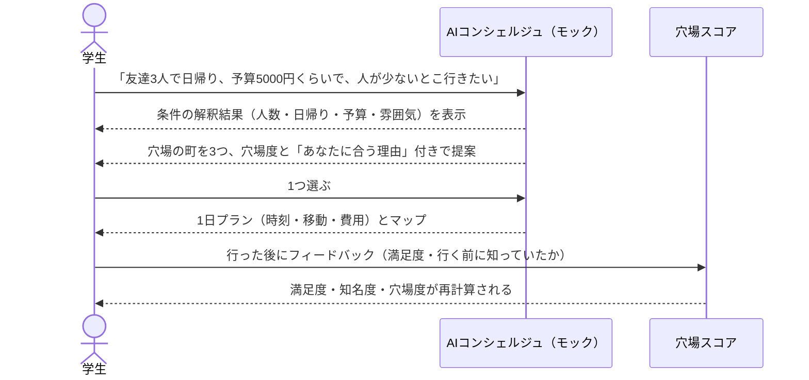

# 穴場 PoC 要件定義書

> **最終更新**: 2026-09-24 / **オーナー**: 土井
> **位置づけ**: 暫定（9/24 21:00 提出の PoC 用。チームの正式な仕様は未確定）
> **スコープ**: `poker` リポジトリの `poc` ブランチで新しく作る PoC。`demo` ブランチのコードは一切使わない。チーム全体の企画・背景は `hack-stage/docs/README.md`、大会ルールは `hack-stage/docs/kickoff.md` を参照。

---

## 1. 目的

**あまり知られていない地域に人を呼び、地域創生につなげる。** そのために、こうした地域を「穴場」として紹介する。AI は、行き先を決められない人と穴場を結びつけるための手段として使う。

**締め切り:** 2026-09-24 21:00

## 2. コンセプト

- 有名な観光地ではなく、知名度は低いが行った人の満足度が高い場所を「穴場」として紹介する
- 穴場かどうかは編集部が選ぶのではなく、**訪れた人のフィードバックから計算する**
  - 穴場度 = 満足度 − 知名度
  - 満足度も知名度も、フィードバックから算出する（計算方法は5章）
- 行き先を決められない人でも、普通の言葉で相談すれば AI が穴場の町と1日の過ごし方を提案する

## 3. 利用者とデモで見せる場面

- **利用者:** 旅行には行きたいが、行き先を決められない学生（友達と行く）
- **デモの流れ（発表7分のうち約2分）:**

## 4. 機能要件

優先度は Must（21:00 までに必須）/ Should（時間があれば）。

| ID | 機能 | 優先度 | 受け入れ条件 |
| --- | --- | --- | --- |
| F1 | 自然文で相談する | Must | テキスト入力欄に自由に書いて送信できる。例文ボタン（3つ）から1タップでも送れる |
| F2 | 条件の解釈を見せる | Must | 入力から「誰と・人数・日帰り/泊まり・予算・移動時間・雰囲気」を取り出してチップで表示する。チップを押すと修正できる。取り出せなかった項目は「指定なし」と表示する |
| F3 | 穴場の町を提案する | Must | 条件に合う町を穴場度の高い順に3つ表示する。各候補に穴場度、見どころ、「あなたに合う理由」（1〜2文）を付ける。該当が0件なら、どの条件を緩めれば出るかを返す |
| F4 | 1日プランを出す | Must | 選んだ町の1日の行程を、時刻・場所・滞在時間・移動・費用の目安付きで表示する。合計費用が予算を超える場合は警告を出す |
| F5 | マップ | Must | 地図上に町とスポットを表示する。穴場度に応じて色を変える。1日プランを選んでいるときは、回る順に番号と線を表示する。スポットを押すと詳細が出る |
| F6 | フィードバックを送る | Must | スポットごとに「満足度（5段階）」と「行く前にこの場所を知っていたか（はい/いいえ）」を送れる。送ると満足度・知名度・穴場度が再計算され、画面に反映される |
| F7 | デモ用リセット | Must | ボタン1つで初期データに戻せる |
| F8 | AI の「考え中」表示 | Should | 応答までの間、解析の段階（条件を読み取り中 → 候補を探索中 → プランを作成中）を順に表示する |
| F9 | 有名どころとの比較 | Should | 提案した町の横に、同じエリアの有名観光地との比較（知名度・穴場度）を表示する |

## 5. 計算の仕様

満足度と知名度は、どちらもフィードバックから算出する。同じ0〜5の尺度にそろえて、引き算で比べられるようにする。

| 項目 | 定義 |
| --- | --- |
| 満足度 | フィードバックの満足度（1〜5）の平均 |
| 知名度 | `5 × 行く前に知っていた人の割合`。全員知っていたら5、誰も知らなければ0 |
| 穴場度 | `満足度 − 知名度`。小数第1位まで |
| 穴場ラベル | 3以上「ど穴場」／2以上「穴場」／1以上「やや穴場」／1未満「知られている」 |
| 件数が少ないとき | フィードバックが5件未満のスポットは「評価集計中」と表示し、穴場度の順位付けから外す |
| 町の穴場度 | その町のスポットの穴場度の平均 |

**注意:** 式は PoC 用の仮置き。とくに知名度は「来た人が知っていたか」で測るため、来ていない人の認知は反映されない。正式な式はチームで決める。

## 6. AI（モック）の仕様

| 項目 | 内容 |
| --- | --- |
| 方式 | 固定ルールによるモック。外部 API は呼ばない |
| 条件の解釈 | キーワードと数値を取り出す。例:「3人」→ 人数、「日帰り」→ 日帰り、「5000円」「5千円」「1万」→ 予算、「静か」「人が少ない」→ 雰囲気=静か |
| 提案理由の文 | 条件とスポットの属性を組み合わせたテンプレートで作る |
| 応答の待ち時間 | AI らしさを出すため、1.5〜2.5秒ほど待ってから段階的に表示する |
| 差し替え | `interpret()`（解釈）と `recommend()`（提案）の2つの関数に分けておく。後から Claude API に置き換えても画面側は変えなくて済むようにする |
| 異常系 | 何も取り出せない入力（例:「どこか」）には、聞き返しを1つ返す（例:「誰と行きますか？」） |

## 7. データ

- **舞台:** 茨城県（仮）。比較対象の有名観光地は同じ県内から選ぶ
  - 選んだ理由: 都道府県の魅力度ランキングで最下位になることが多く、「知名度は低いが行けば良い」という今回のテーマを説明しやすい。都心から日帰りできる
- **スポット数:** 町4〜5つ × 各3〜4スポット
- **内容:** スポット名・種類（食べる/見る/体験）・説明・緯度経度・滞在時間・費用の目安・初期のフィードバック（各スポット5〜20件）
- **注意:** フィードバック・費用はサンプル値（架空）。画面にも「サンプルデータ」と表示する

## 8. 非機能要件

| 項目 | 内容 |
| --- | --- |
| 動作環境 | PC ブラウザ（発表用）とスマホ幅（375px）の両方で崩れない |
| 起動 | `npm install` → `npm run dev` だけで動く。バックエンドなし |
| 保存 | フィードバックはブラウザの localStorage に保存する。保存できない環境でも動く |
| ネット接続 | 地図タイル以外はオフラインでも動く。地図が読み込めなくても他の画面は使える |
| 技術 | React + TypeScript + Vite + Tailwind CSS、地図は Leaflet |
| テスト | 計算の仕様（5章）と条件の解釈（6章）は Vitest で自動テストする |

## 9. 対象外

今回は作らない:

- 実際の AI API 呼び出し（6章のとおりモック）
- ポイント・称号・チェックインなどのゲーム要素
- ログイン・アカウント・複数人でのデータ共有
- 予約、クーポン、共有リスト
- 地元の人による投稿機能
- 実データ連携（自治体のオープンデータ API など）

## 10. 完了条件

- [ ] 3章のデモの流れを、止まらずに最後まで操作できる
- [ ] Must の機能（F1〜F7）がすべて受け入れ条件を満たす
- [ ] `npm run build` と `npm test` が通る
- [ ] `poc` ブランチにコミットされている

## 11. 未定義事項

- 舞台の地域はチームで未決定（7章は PoC 用の仮置き）
- 穴場度・満足度・知名度の式は仮置き（5章）
- 提出方法（URL・リポジトリ・動画など）が未確認
