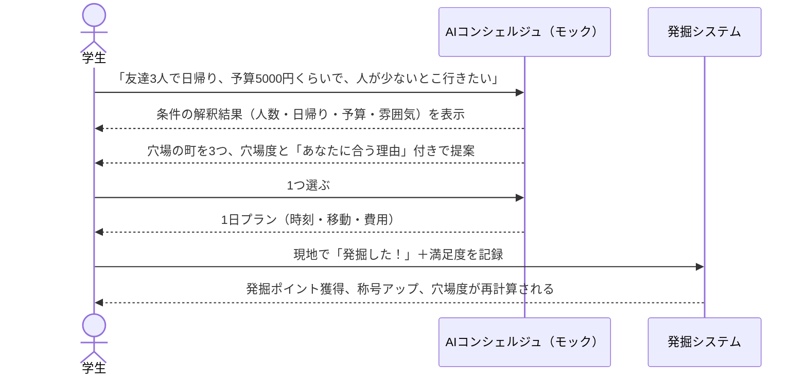

# 穴場 PoC 要件定義書

> **最終更新**: 2026-09-24 / **オーナー**: 土井
> **位置づけ**: 暫定（9/24 21:00 提出の PoC 用。チームの正式な仕様は未確定）
> **スコープ**: `poker` リポジトリの `poc` ブランチで新しく作る PoC。`demo` ブランチのコードは一切使わない。チーム全体の企画・背景は `hack-stage/docs/README.md`、大会ルールは `hack-stage/docs/kickoff.md` を参照。

---

## 1. 目的

「自然な言葉で相談すると、AI が穴場の町と1日プランを返す」「穴場を見つけた人ほど報われる」の2点を動く形で見せ、チームの方向性を判断する材料にする。

**締め切り:** 2026-09-24 21:00

## 2. コンセプト

> **穴場は、見つかるほど穴場じゃなくなる。だから、先に見つけた人が偉い。**

- 穴場度は編集部が決めるのではなく、利用者の行動から計算する（穴場度 = 満足度 − 知名度）
- 人が訪れるほど知名度が上がり、穴場度は下がる。穴場度が高いうちに行った人ほど多くの「発掘ポイント」をもらえる
- この仕組みで、既存の地域アプリがつまずいた「利用者が集まらない」に答える。早く行く動機を作れば、行った人がそのまま次の利用者を呼ぶ

## 3. 利用者とデモで見せる場面

- **利用者:** 旅行には行きたいが、行き先を決められない学生（友達と行く）
- **デモの流れ（発表7分のうち約2分）:**

## 4. 機能要件

優先度は Must（21:00 までに必須）/ Should（時間があれば）/ Could（今回はやらない可能性が高い）。

| ID | 機能 | 優先度 | 受け入れ条件 |
| --- | --- | --- | --- |
| F1 | 自然文で相談する | Must | テキスト入力欄に自由に書いて送信できる。例文ボタン（3つ）から1タップでも送れる |
| F2 | 条件の解釈を見せる | Must | 入力から「誰と・人数・日帰り/泊まり・予算・移動時間・雰囲気」を取り出してチップで表示する。チップを押すと修正できる。取り出せなかった項目は「指定なし」と表示する |
| F3 | 穴場の町を提案する | Must | 条件に合う町を穴場度の高い順に3つ表示する。各候補に穴場度、見どころ、「あなたに合う理由」（1〜2文）を付ける。該当が0件なら、どの条件を緩めれば出るかを返す |
| F4 | 1日プランを出す | Must | 選んだ町の1日の行程を、時刻・場所・滞在時間・移動・費用の目安付きで表示する。合計費用が予算を超える場合は警告を出す |
| F5 | 発掘する（チェックイン） | Must | スポットで「発掘した！」を押し、満足度を5段階で付けられる。記録すると訪問数と満足度が更新され、穴場度が再計算される |
| F6 | 発掘ポイントと称号 | Must | 発掘ごとにポイントが加算され、累計ポイントで称号が上がる。獲得時に内訳（穴場度 × 先行ボーナス）を表示する |
| F7 | AI の「考え中」表示 | Should | 応答までの間、解析の段階（条件を読み取り中 → 候補を探索中 → プランを作成中）を順に表示する |
| F8 | 発掘マップ | Should | 地図上にスポットを表示する。未発掘の場所は霧（フォグ）で覆い、発掘すると晴れる |
| F9 | 有名どころとの比較 | Should | 提案した町の横に、同じエリアの有名観光地（例: 長瀞）との比較（混雑の目安・穴場度）を表示する |
| F10 | 足跡メッセージ | Could | 発掘時に、決まった型から選んで短いメッセージを残せる（例:「この先、〇〇あり」）。自由文は使わない（荒らし対策） |
| F11 | デモ用リセット | Must | ボタン1つで初期データに戻せる |

## 5. 計算の仕様

| 項目 | 定義 |
| --- | --- |
| 満足度 | 発掘時の評価（1〜5）の平均。初期値はサンプルデータで持つ |
| 知名度 | 訪問数から算出する。`知名度 = min(5, log10(訪問数 + 1) × 1.25)`（訪問数1万で5） |
| 穴場度 | `満足度 − 知名度`。小数第1位まで |
| 穴場ラベル | 3以上「ど穴場」／2以上「穴場」／1以上「やや穴場」／1未満「知られている」 |
| 先行ボーナス | 訪問数が10人以下なら ×3、100人以下なら ×2、それより多ければ ×1 |
| 発掘ポイント | `max(1, round(穴場度 × 10)) × 先行ボーナス`。同じスポットの発掘は1回まで |
| 称号 | 0pt「旅人」／50pt「探検家」／150pt「穴場ハンター」／300pt「開拓者」 |

**式の根拠:** 知名度が0〜5、満足度が1〜5で同じ尺度になるため、単純な引き算で比べられる。この値は PoC 用の仮置きで、正式な式はチームで決める。

## 6. AI（モック）の仕様

| 項目 | 内容 |
| --- | --- |
| 方式 | 固定ルールによるモック。外部 API は呼ばない |
| 条件の解釈 | キーワードと数値を取り出す。例:「3人」→ 人数、「日帰り」→ 日帰り、「5000円」「5千円」「1万」→ 予算、「静か」「人が少ない」→ 雰囲気=静か |
| 提案理由の文 | 条件とスポットの属性を組み合わせたテンプレートで作る |
| 応答の待ち時間 | AI らしさを出すため、1.5〜2.5秒ほど待ってから段階的に表示する |
| 差し替え | `interpret()`（解釈）と `recommend()`（提案）の2つの関数に分けておく。後から Claude API に置き換えても画面側は変えなくて済むようにする |
| 異常系 | 何も取り出せない入力（例:「どこか」）には、聞き返しを1つ返す（例:「誰と行きますか？」） |

## 7. データ

- **舞台:** 埼玉県北部（熊谷・行田・深谷・寄居・妻沼など）。比較対象の有名観光地は長瀞・秩父
  - 選んだ理由: 熊谷市がオープンデータで観光情報を公開している（README 3章）。都心から日帰りできる
- **スポット数:** 町4〜5つ × 各3〜4スポット
- **内容:** スポット名・種類（食べる/見る/体験）・説明・緯度経度・滞在時間・費用の目安・初期訪問数・初期満足度
- **注意:** 訪問数・満足度・費用はサンプル値（架空）。画面にも「サンプルデータ」と表示する

## 8. 非機能要件

| 項目 | 内容 |
| --- | --- |
| 動作環境 | PC ブラウザ（発表用）とスマホ幅（375px）の両方で崩れない |
| 起動 | `npm install` → `npm run dev` だけで動く。バックエンドなし |
| 保存 | 発掘の記録とポイントはブラウザの localStorage に保存する。保存できない環境でも動く |
| ネット接続 | 地図タイル以外はオフラインでも動く。地図が読み込めなくても他の画面は使える |
| 技術 | React + TypeScript + Vite + Tailwind CSS、地図は Leaflet |
| テスト | 計算の仕様（5章）と条件の解釈（6章）は Vitest で自動テストする |

## 9. 対象外

今回は作らない:

- 実際の AI API 呼び出し（6章のとおりモック）
- ログイン・アカウント・複数人でのデータ共有
- 予約、クーポン、共有リスト
- 地元の人による投稿機能
- 実データ連携（熊谷市 API など）
- 本物の位置情報によるチェックイン判定（ボタンを押すだけで発掘扱い）

## 10. 完了条件

- [ ] 3章のデモの流れを、止まらずに最後まで操作できる
- [ ] Must の機能（F1〜F6、F11）がすべて受け入れ条件を満たす
- [ ] `npm run build` と `npm test` が通る
- [ ] `poc` ブランチにコミットされている

## 11. 未定義事項

- 舞台の地域はチームで未決定（7章は PoC 用の仮置き）
- 穴場度と発掘ポイントの式は仮置き（5章）
- 提出方法（URL・リポジトリ・動画など）が未確認
