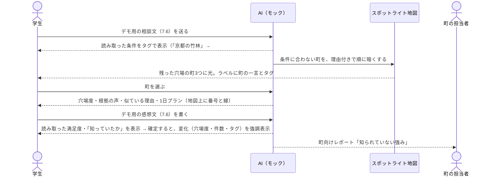

# 穴場 PoC 要件定義書

> **最終更新**: 2026-09-24（v2: 日本全体の地図・ナビゲーションバー・マイページを追加）/ **オーナー**: 土井
> **位置づけ**: 暫定（9/24 21:00 提出の PoC 用。チームの正式な仕様は未確定）
> **スコープ**: `poker` リポジトリの `poc` ブランチで新しく作る PoC。`demo` ブランチのコードは一切使わない。チーム全体の企画・背景は `hack-stage/docs/README.md`、大会ルールは `hack-stage/docs/kickoff.md`、機能を選んだ根拠は同じフォルダの調査資料（[differentiation-research.md](differentiation-research.md)、[ai-capabilities-research.md](ai-capabilities-research.md)、[wow-ideas.md](wow-ideas.md)）を参照。

---

## 1. 目的

**あまり知られていない地域に人を呼び、地域創生につなげる。** そのために、こうした地域を「穴場」として紹介する。AI は、行き先を決められない人と穴場を結びつけるための手段として使う。

**締め切り:** 2026-09-24 21:00

## 2. コンセプト

- 有名な観光地ではなく、知名度は低いが行った人の満足度が高い場所を「穴場」として紹介する。**人気の場所は扱わない**
- 穴場かどうかは編集部が選ぶのではなく、**訪れた人の声（感想）から AI が点数を付けて計算する**
  - 穴場度 = 満足度 − 知名度
- 知らない町は名前だけでは想像できない。だから **AI が声を「町の一言」と「タグ」に変え、知っている有名地の言葉からも探せるようにする**
- 集めた声は旅行者だけでなく、**町の側にも「知られていない強み」として返す**

## 3. 機能の全体像

「町」は市町村を指す。地図の塗り分けも、提案も、町向けレポートも市町村の単位で行う。

| # | 機能 | 種類 | ひとことで |
| --- | --- | --- | --- |
| D1 | スポットライト地図 | 差別化 | 暗い地図の上で、穴場の町だけに光が当たる |
| D2 | 声から点数を付ける AI | 差別化 | 自由に書いた感想から、AI が満足度と「知っていたか」を読み取り、穴場度を出す |
| D3 | 町向けレポート | 差別化 | 「知らなかったのに満足した人」の声を、町の強みとしてまとめて返す |
| D4 | 有名地の言葉 → 穴場 | 差別化 | 「京都の竹林みたいなところ」を、似た体験ができる穴場の町に変える |
| D5 | 町の一言とタグ | 差別化 | 感想から、町の一言（例:「夕焼けと海鮮の町」）と特徴のタグ（例: #静か #海鮮）を AI が作る |
| B1 | 相談する | 土台 | 自然な文章で相談する |
| B2 | 条件をタグで見せる | 土台 | 相談文から読み取った条件をタグで表示する |
| B3 | 穴場の町を提案する | 土台 | 条件に合う町を3つ出す |
| B4 | 1日プラン | 土台 | 選んだ町の1日の行程を出す |
| B5 | デモ用リセット | 土台 | 初期データに戻す |
| N1 | 日本全体の地図 | 追加 | 最初は日本全体を暗く表示し、対応している茨城県北だけが光る。そこから県北へズームする |
| N2 | ナビゲーションバー | 追加 | ヘッダーに4つのページ（さがす／ダッシュボード／町向けレポート／穴場度とは）とリセットを置く |
| N3 | ダッシュボード（マイページ） | 追加 | 旅行者が、自分の書いた声・行った町・気になる町を見返す |
| N4 | 穴場度とは | 追加 | コンセプトと穴場度の計算を説明するページ |
| N5 | イメージ写真 | 追加 | 町とスポットに、サンプルのイメージ写真を付ける |

### デモの流れ（発表7分のうち約2分）

## 4. 機能要件

すべて Must。作る順番と、遅れたときの簡易版は10章。

### 差別化機能

| ID | 機能 | 受け入れ条件 |
| --- | --- | --- |
| D1-1 | 市町村の塗り分け | 舞台の市町村（7.1）を境界で区切って表示する。背景は暗い単色で、背景地図のタイルがなくても表示できる。画面の隅に境界データの出典を表示する |
| D1-2 | スポットライト | 提案した町だけを明るく、ほかの町をうっすら暗く表示する（透明度は0にしない）。光った町には、町の一言とタグ（D5）をラベルで出す。暗い町もクリックでき、声のある町は町の詳細を、声のない町は「まだ声が集まっていません」を表示する |
| D1-3 | 絞り込みの演出 | 相談を送ってから、条件に合わない町が1町ずつ短い理由（7.4 の理由文）付きで暗くなり、最後に残った町に光が当たる。送信から光が当たるまで4秒以内（6章の待ち時間を含む） |
| D1-4 | 町の中の表示 | 町を選ぶとその町へズームし、スポットを表示する。1日プランのスポットは、回る順に番号と線でつなぐ |
| D2-1 | 感想を書く | スポットごとに感想を自由に書いて送れる。入力画面には、その場所の今の点数を表示しない |
| D2-2 | AI が読み取る | 送った感想から、AI が「満足度（1〜5）」「行く前に知っていたか（知っていた/知らなかった/不明）」「根拠になった文」「特徴のタグ（7.3 の語彙から）」を読み取り、確定前に表示する。満足度を判定できなかったときは3を入れ、「判定できませんでした。直してください」と表示する。利用者は読み取り結果を直してから確定できる |
| D2-3 | 穴場度を出す | 確定した声を集計し、5章の式で満足度・知名度・穴場度を計算し直して、画面に反映する。点数の横に件数（例: n=12）を表示し、5件未満は「参考値」と付ける |
| D2-4 | 根拠の声を見せる | 提案カードに、根拠の声を2〜3件引用する。選び方: 「知らなかった」かつ満足度4以上の声から新しい順。足りなければ満足度4以上の声から新しい順。引用を押すと感想の原文が読める。声で裏付けられない理由の文は出さない |
| D2-5 | 変化を見せる | 感想を確定したら、そのスポットの値を「前 → 後」の形で強調表示する: 穴場度（例: 2.3 → 2.5）、件数（n=5 → 6）、満足度、知名度。町の値（穴場度・件数）も並べて「前 → 後」で出す（変化が0.0でも表示する）。タグの件数が増えたとき、新しいタグが入ったときは、そのタグを目立たせる |
| D3-1 | 町向けレポート | 町を選んで「町向けレポート」を開くと、次を表示する: ①「行く前は知らなかったのに満足した人」が挙げた良い点の上位3つ（タグと件数）、② 不満として挙がった点（件数付き。なければ「目立った不満はなし」）、③ その町を紹介する発信文の案（1〜2文） |
| D4-1 | 有名地の言葉を読み取る | 相談文に有名地辞書（7.5）の言葉があると、体験のタグに変換し、条件のタグ（B2）と一緒に「京都の竹林 → #竹 #静か #散策」の形で表示する |
| D4-2 | 似ている理由を示す | 提案した町ごとに、その有名地と一致したタグと、それを裏付ける声を1件表示する（例:「#竹 #静か が一致。『竹の小道を独り占めできた』」）。画面の言葉は「似た体験ができる」とし、「同じ」「代わり」とは書かない |
| D4-3 | 知らない有名地 | 「〇〇みたいな」「〇〇っぽい」の〇〇が辞書にない場合は、有名地として扱わず、ほかの条件だけで提案する。そのことを「『〇〇』はまだ対応していないので、ほかの条件で探しました」と1行で伝える |
| D5-1 | 町の一言 | 町ごとに、声から作った一言（15字以内）を持つ。地図のラベル（D1-2）と提案カード（B3）に表示する |
| D5-2 | タグ | 町ごとに、声から読み取った特徴のタグを3〜5個持つ。各タグに、そのタグの元になった声の件数を持つ。地図のラベルと提案カードに表示する |
| D5-3 | 声で更新される | 感想を確定する（D2-2）と、その町の一言とタグが作り直される |

### 追加機能（v2）

| ID | 機能 | 受け入れ条件 |
| --- | --- | --- |
| N1-1 | 日本全体の表示 | 「さがす」を開いた最初の状態で、日本全体を都道府県の境界で暗く表示する。対応している茨城県北の6市町（7.1）だけを明るく表示し、「対応エリア: 茨城県北」とラベルを出す。背景地図のタイルなしで表示できる |
| N1-2 | 県北へのズーム | 相談を送るか、茨城県北を押すと、県北の範囲へなめらかにズームし、既存の D1 の表示に切り替わる。相談を送った場合は、ズームが終わってから D1-3 の絞り込みの演出を始める（ズームの時間は D1-3 の4秒に含めない。ズームは1.5秒以内） |
| N1-3 | 対応していない地域 | 茨城県北以外の都道府県を押すと、「この地域はまだ準備中です」と表示する。提案には出さない |
| N1-4 | 日本全体に戻る | 県北を表示しているときは「日本全体を見る」ボタンを出し、押すと N1-1 の状態に戻る |
| N2-1 | ヘッダーのナビゲーション | すべてのページの上部に固定で、ロゴ「穴場」と4つのリンク（さがす／ダッシュボード／町向けレポート／穴場度とは）、右端にリセット（B5）を置く。今いるページのリンクを強調する |
| N2-2 | ページの切り替え | ページは URL のハッシュ（例: `#/search`、`#/dashboard`、`#/report`、`#/about`）で切り替える。再読み込みしても同じページが開く。サーバーは不要 |
| N2-3 | スマホ幅 | 375px でもヘッダーの高さは1行に収め、4つのリンクはメニューボタンから開く |
| N3-1 | 自分の声 | このブラウザで確定した声（D2-2）だけを「あなたの声」として新しい順に一覧する。各行に、町・スポット・感想の冒頭・読み取り結果（満足度・知っていたか・タグ）・日時を出す。押すと「さがす」でその町を開く。サンプルの声は含めない |
| N3-2 | 行った町 | 自分の声を書いた町を一覧し、町ごとに書いた声の件数と、その町の今の穴場度を出す |
| N3-3 | 気になる町 | 提案カード（B3）と町の詳細に「気になる」ボタンを置き、押した町を一覧する。もう一度押すと外れる。一覧から「さがす」でその町を開ける |
| N3-4 | まとめの数字 | 書いた声の数・行った町の数・気になる町の数を上部に出す。点数やランキング、称号は出さない |
| N3-5 | 何もないとき | 声も気になる町もないときは、「さがす」へのリンク付きで使い方を1行で案内する |
| N4-1 | 町向けレポートのページ | 町を選ぶ欄と、選んだ町の D3-1 のレポートを表示する。「さがす」の町の詳細から開いたときは、その町を選んだ状態で開く |
| N4-2 | 穴場度とは | コンセプト（2章）、穴場度の式と件数による補正（5章）を図や例で説明する。データがサンプルであること、境界データの出典も書く |

| N5-1 | 写真を表示する | 町とスポットに1枚ずつイメージ写真を持ち、提案カード（B3）・町の詳細・スポットの詳細・1日プラン（B4）・ダッシュボード（N3）に表示する |
| N5-2 | イメージであることの表示 | 写真の上か下に「イメージ写真（実際の場所ではありません）」と小さく表示する |
| N5-3 | 写真の条件 | 商用利用可で再配布できるライセンスの写真（例: Unsplash・Pexels のライセンス、CC0、CC BY）だけを使う。AI で生成した画像は使わない。人物の顔が分かる写真は使わない。写真の内容は、そのスポットの種類やタグ（例: #竹 → 竹林、#海鮮 → 海鮮料理）に合わせる |
| N5-4 | 同梱と軽さ | 写真はアプリに同梱し、通信なしで表示する。1枚あたり 150KB 以下（WebP など）、幅は 1200px 以下にする |
| N5-5 | 出典の記録 | 写真ごとに、撮影者・入手元の URL・ライセンスを1つのファイルにまとめ、「穴場度とは」（N4-2）のページに一覧する |
| N5-6 | 読み込めないとき | 写真が読み込めなかったときは、スポットの種類に応じた単色の代わりの表示を出し、レイアウトを崩さない |

### 土台の機能

| ID | 機能 | 受け入れ条件 |
| --- | --- | --- |
| B1 | 相談する | 自由に書いて送信できる。入力欄はチャット欄の一番下に固定し、やりとりはその上に積み上げる（一般的なチャットと同じ配置）。例文ボタン（3つ。うち1つは7.6 のデモ用の相談文）は、まだ何も送っていないときだけ入力欄のすぐ上に出し、押したらそのまま送信して例文ボタンを消す（入力欄に文字を残さない）。送信したら入力欄は空にする。AI が聞き返したとき（6章 `interpret`）は、その質問をチャット欄に AI の発言として表示し、条件のタグは出さない |
| B2 | 条件をタグで見せる | 相談文から「誰と・人数・日帰り/泊まり・予算・片道の移動時間・雰囲気」を読み取ってタグで表示する。雰囲気は7.3 の語彙から選ぶ。タグを押すと直せる。読み取れなかった項目は「指定なし」と表示する |
| B3 | 穴場の町を提案する | 7.4 の除外ルールで残った町を、次の順で最大3つ表示する: 有名地のたとえがあれば一致度の高い順（同じなら穴場度の高い順）、なければ穴場度の高い順。各候補に、穴場度・穴場ラベル・件数・町の一言とタグ（D5）・根拠の声（D2-4）を付ける。0件なら、どの条件を緩めれば出るかを返す |
| B4 | 1日プラン | 選んだ町の1日の行程を、7.2 のデータから、時刻・場所・滞在時間・移動時間・費用の目安付きで表示する。「往復交通費＋スポットの費用の合計」が予算を超える場合は警告を出す。泊まりの場合も1日目の行程だけを出し、「1日目のプラン」と表示する |
| B5 | デモ用リセット | ボタン1つで初期データに戻せる |

## 5. 計算の仕様

満足度と知名度は、AI が声から読み取った値（D2-2）を集計して出す。件数が少ないときに点数が大きくぶれないよう、どちらも全体の平均に少し寄せて補正する（ベイズ平均）。

| 項目 | 定義 |
| --- | --- |
| 全体の平均満足度 | すべての町・スポットの声の満足度の単純平均 |
| スポットの満足度 | `(5 × 全体の平均満足度 ＋ そのスポットの満足度の合計) ÷ (5 ＋ そのスポットの件数)` |
| 知っていた人の割合 | `(知っていた人数 ＋ 1) ÷ (知っていた・知らなかったの回答数 ＋ 2)`。「不明」は数えない |
| スポットの知名度 | `5 × 知っていた人の割合`（0〜5） |
| スポットの穴場度 | `満足度 − 知名度`。小数第1位まで |
| 町の満足度・知名度・穴場度 | その町のスポットの値を、スポットの件数で重み付けした平均 |
| 穴場ラベル | 3以上「ど穴場」／2以上「穴場」／1以上「やや穴場」 |
| 候補から外す条件 | 町の満足度が3.5未満、または町の穴場度が1未満の町は提案しない（穴場でない町と、知名度が低いだけの町を出さないため） |
| 有名地との一致度（D4） | 有名地の体験のタグのうち、町のタグ（D5-2）に含まれる割合（0〜1） |

**注意:** 式は PoC 用の仮置き。知名度は「来た人が知っていたか」で測るので、来ていない人の認知は反映されない。

## 6. AI（モック）の仕様

外部 API は呼ばず、固定ルールで動かす。画面側を変えずに Claude API に置き換えられるよう、次の5つの関数に分ける。

| 関数 | 役割 | モックでの作り方 |
| --- | --- | --- |
| `interpret(相談文)` | 相談文から条件と有名地のたとえを読み取る（B2・D4-1） | キーワードと数値を取り出す。例:「3人」→ 人数、「日帰り」、「5000円」「5千円」「1万」→ 予算、「2時間以内」→ 片道の移動時間。雰囲気は7.3 の語彙の辞書で判定する（例:「人が少ない」→ #静か）。有名地は7.5 の辞書と照合し、体験のタグに変換する。何も読み取れなければ、聞き返しを1つ返す（例:「誰と、どんな雰囲気のところに行きたいですか？」） |
| `recommend(条件)` | 町を絞り込み、提案と理由を返す（B3・D1-3・D4-2） | 7.4 の除外ルールを上から順に当て、外した町と理由文を返す。残った町を B3 の順で並べる。提案の理由は、根拠の声（D2-4）を引用するテンプレートで作る |
| `analyzeVoice(感想)` | 感想から満足度・知っていたか・根拠の文・特徴のタグを読み取る（D2-2） | 言葉の辞書で判定する。満足度: 3から始め、「最高」「また来たい」で上げ、「残念」「微妙」で下げる（1〜5に収める。判定の言葉が1つもなければ「判定できなかった」として3）。知っていたか:「知らなかった」「初めて知った」→ 知らなかった、「前から気になって」「有名」→ 知っていた、どちらもなければ「不明」。特徴のタグ: 7.3 の語彙の辞書で判定する。根拠の文: 判定に使った言葉を含む一文 |
| `summarizeTown(町)` | 町の一言とタグを作る（D5） | 満足度4以上の声の特徴のタグを数え、件数2以上のタグを多い順に最大5個選ぶ。3個に届かなければ件数1のタグも足す。件数が同じときは7.3 の語彙の順。一言は上位2つのタグの「一言用の言葉」（7.3）を「〇〇と△△の町」に当てはめて作る（例:「竹と静けさの町」）。15字を超えたら上位1つだけで作る |
| `buildReport(町)` | 町向けレポートを作る（D3-1） | 良い点: 「知らなかった」かつ満足度4以上の声の特徴のタグを数え、上位3つ。不満: 満足度2以下の声から、不満の辞書（例:「駐車場」「分かりにくい」「混んで」「高い」「閉まって」）に当たる言葉を数える。発信文: 良い点の上位2つを組み合わせるテンプレートで作る |

- **応答の待ち時間:** AI らしさを出すため待ち時間を入れる。相談の送信では待ち時間は1回だけにし、`interpret` と `recommend` をまとめて扱う。送信から0.5秒で条件のタグを表示 → 0.5〜3秒で町を1町ずつ暗くする → 3.5秒で残った町に光を当てる（D1-3 の4秒以内に収める）。感想の読み取り（`analyzeVoice`）とレポート（`buildReport`）は1.5秒待ってから表示する
- **誤読への備え:** AI の読み取り結果は必ず利用者に見せ、直せるようにする（D2-2）
- **事実は変えない:** 一言・タグ・発信文は声の言葉と7.3 の語彙から作り、声にない事実（店名・数字・営業時間）は書かない
- **拡張性:** 声の取り込み元（観光地のアンケート、口コミサイトなど）を増やしても、`analyzeVoice` 以降はそのまま使える

## 7. データ

**注意:** 感想・費用・所要時間はサンプル（架空または目安）。画面にも「サンプルデータ」と表示する。

### 7.1 舞台と市町村

- **舞台:** 茨城県北（仮）の6市町（日立市・常陸太田市・高萩市・北茨城市・常陸大宮市・大子町）
  - 選んだ理由: 茨城は都道府県魅力度ランキングで下位の常連。県内で入込客数が前年より減っているのは県北だけ（前年比93.0%。茨城県「令和7年 観光客動態調査報告」）。都心から日帰りできる
- **日本全体の境界（N1）:** 都道府県の境界を、軽くしてアプリに同梱する（通信なしで表示するため）。出典を画面に表示する
- **声とスポットのデータを持つ町:** 6市町のうち5つ。残る1つは「まだ声が集まっていません」の表示用（D1-2）
- **境界データ:** 国土数値情報の「行政区域」（N03）から6市町を取り出し、行政区域コードで1町1図形にまとめる。mapshaper で10%程度に簡略化して、GeoJSON を200KB以下にしてアプリに同梱する

### 7.2 町とスポットの項目

| 対象 | 項目 |
| --- | --- |
| 町 | 名前、行政区域コード、東京駅からの片道所要時間（分）、往復交通費（円）、向いている相手（友達と/ひとり/ふたり/家族と） |
| スポット | 名前、所属する町、種類（食べる/見る/体験）、説明、緯度経度、1日プランで回る順番、滞在時間（分）、次のスポットまでの移動時間（分）、費用の目安（円） |
| 声 | 所属するスポット、感想文、満足度、知っていたか、特徴のタグ、根拠の文、投稿日時 |

- **1日プランの時刻:** 開始は10:00で固定。各スポットの時刻は、開始時刻に前のスポットまでの滞在時間と移動時間を足して計算する

### 7.3 タグの語彙

有名地辞書の体験のタグ・声の特徴のタグ・町のタグ・B2 の雰囲気は、すべて次の20語から選ぶ（表記ゆれで一致しなくなるのを防ぐため）。

`#静か #自然 #渓谷 #滝 #海 #海鮮 #竹 #散策 #寺社 #高台 #夕焼け #星空 #温泉 #そば #カフェ #歴史 #体験 #紅葉 #朝市 #避暑`

各タグに、次の2つを持つ。
- 感想文から判定するための言葉の辞書（例: #静か ←「静か」「人が少ない」「独り占め」、#竹 ←「竹」「竹林」）
- 町の一言に使う言葉（例: #静か → 静けさ、#竹 → 竹、#海鮮 → 海鮮）

### 7.4 条件と除外ルール

`recommend` は上から順に当てる。

| 条件・ルール | 除外する町 | 理由文（D1-3） |
| --- | --- | --- |
| 日帰り | 片道所要時間が120分を超える町（泊まりなら制限なし） | 「日帰りには遠い（片道◯分）」 |
| 片道の移動時間 X | 片道所要時間が X を超える町 | 「片道◯分かかる」 |
| 予算 Y | 往復交通費＋スポットの費用の合計が Y を超える町 | 「予算を超える（約◯円）」 |
| 誰と | 向いている相手に含まれない町 | 「◯◯向きではない」 |
| 雰囲気（タグ） | そのタグを持たない町 | 「#◯◯ の声がない」 |
| 有名地のたとえ | 一致度が0の町 | 「◯◯に似た声がない」 |
| 満足度 | 町の満足度が3.5未満 | 「満足度が低い」 |
| 穴場度 | 町の穴場度が1未満 | 「もう知られている」 |

人数は除外に使わない（表示のみ）。予算は1人あたりの金額として扱い、7.4 の判定と B4 の警告も1人あたりで比べる。

### 7.5 有名地辞書

有名地のたとえ10件と、それぞれの体験のタグ（7.3 の語彙から2〜4個）。例: 京都の竹林 → #竹 #静か #散策、軽井沢 → #避暑 #自然 #カフェ、奥入瀬 → #渓谷 #滝 #自然。

### 7.6 デモ用の文とデータの制約

- **デモ用の相談文:** 「友達3人で日帰り、京都の竹林みたいな静かなとこ行きたい。予算は1万円くらい」
  - この文で、声のある5町のうち2町が理由付きで暗くなり、ちょうど3町が残るようにデータを作る。声のない6町目は最初から暗くしておき、演出の対象に含めない
  - 往復交通費は実際の運賃に近い目安にする（予算を1万円にしているのはこのため）
- **デモ用の感想文:** 「名前も知らなかったけど、竹の小道を独り占めできて最高。また来たい」
  - 読み取り結果は、満足度5・知らなかった・#竹 #静か
  - 感想を書くスポットは声を5件にしておき、この1件で**スポットの**穴場度が0.2以上上がるように値を調整する（町の穴場度はほかのスポットに薄められるので、大きく動かなくてよい）
- **声の件数:** デモで感想を書くスポット以外は、各5〜20件

## 8. 非機能要件

| 項目 | 内容 |
| --- | --- |
| 動作環境 | PC ブラウザ（発表用）とスマホ幅（375px）の両方で崩れない |
| 起動 | `npm install` → `npm run dev` だけで動く。バックエンドなし |
| 保存 | 声・自分の声の印・気になる町は、ブラウザの localStorage に保存する。保存できない環境でも動く。リセット（B5）で全部消える |
| ネット接続 | 通信なしでもすべて動く（背景地図のタイルを使う場合も、読み込めなければ単色の背景で表示する） |
| 動き | OS で動きを減らす設定が有効なときは、アニメーションを止める。D1-3 は10章の簡易版（一度に暗くし、理由文を一覧で出す）と同じ表示にする |
| 技術 | React + TypeScript + Vite + Tailwind CSS、地図は Leaflet（市町村は SVG で描画する） |
| テスト | 計算（5章）と、AI モックの5関数（6章）を Vitest で自動テストする。`recommend` は並び順・除外・0件のときの提案を、`buildReport` は不満がないときの表示を含める |

## 9. 対象外

今回は作らない:

- 人気順での表示・人気順との比較（穴場に特化するため）
- ポイント・称号・チェックインなどのゲーム要素
- AI で実在の町の画像を作ること
- ガイドブック・レンズ（旅程の紙を撮って穴場に書き換える）、ブラインド旅比べ、光のリレー
- 実際の AI API 呼び出し（6章のとおりモック）
- ログイン・アカウント・複数人でのデータ共有
- 予約、クーポン、共有リスト（N3-3 の「気になる町」はこのブラウザの中だけの一覧で、共有はしない）
- 茨城県北以外の地域のスポットや声のデータ
- 地元の人による投稿
- 実データ連携（自治体のオープンデータ API など）
- 泊まりの2日目以降のプラン

## 10. 作る順番と簡易版

機能は削らない。上から順に作り、遅れたら右の簡易版に切り替える。

| 順 | 作るもの | 遅れたときの簡易版 |
| --- | --- | --- |
| 1 | データ（7章）、5章の計算、6章のモック、テスト | 有名地辞書を3件に減らす |
| 2 | リセット（B5）、B1〜B3、地図の塗り分けとスポットライト（D1-1・D1-2） | — |
| 3 | 声の読み取りと更新（D2）、町の一言とタグ（D5） | D2-5 の強調表示は色を変えるだけにする |
| 4 | 有名地の言葉（D4） | D4-2 の裏付けの声を省き、一致したタグだけ出す |
| 5 | 1日プランと町の中の表示（B4・D1-4） | 地図の線を省き、番号だけにする |
| 6 | 町向けレポート（D3） | 発信文の案を省く |
| 7 | 絞り込みの演出（D1-3） | 1町ずつではなく、一度に暗くする（理由文は一覧で出す） |

## 11. 完了条件

- [ ] 3章のデモの流れを、止まらずに最後まで操作できる
- [ ] 4章の機能がすべて受け入れ条件を満たす（10章の簡易版に切り替えたものは、その内容で満たす）
- [ ] 通信を切った状態でもデモの流れを最後まで操作できる
- [ ] `npm run build` と `npm test` が通る
- [ ] `poc` ブランチにコミットされている

## 12. 未定義事項

- 舞台の地域はチームで未決定（7.1 は PoC 用の仮置き）
- 計算式は仮置き（5章）
- 実際の AI API を使うかどうか（使う場合は `analyzeVoice` から置き換える）
- 提出方法（URL・リポジトリ・動画など）が未確認
